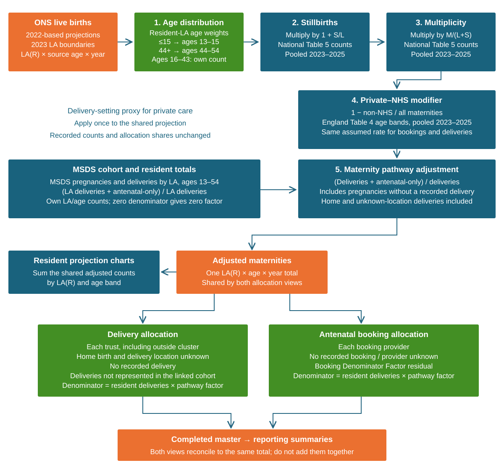

```{r}
#| label: method-1-setup
#| include: false
options(warn = 1) # Keep rendering warnings visible when they occur.
source("R/disclosure.R", encoding = "UTF-8")
source("R/report_colours.R", encoding = "UTF-8")
source("R/ons_data.R", encoding = "UTF-8")
source("R/age_boundary_review.R", encoding = "UTF-8")
library(gt)
library(ggplot2)
library(plotly)
library(scales)

knitr::knit_hooks$set(document = function(x) {
  audit_disclosure_widgets(x)
  x
})

# Only complete outputs from a single successful preparation are rendered.
# This check reads saved results; it does not rerun the analysis or Azure reader.
read_completed_analysis <- function() {
  status_file <- ".analysis_run.rds"
  if (!file.exists(status_file))
    stop("No prepared analysis is available. Run Run analysis.R in UDAL; it creates the report automatically.", call. = FALSE)
  report_run <- readRDS(status_file)
  if (identical(report_run$status, "running")) {
    message("Analysis is running; waiting for the completed report data...")
    expected_run <- report_run$run_id
    for (second in seq_len(1800L)) {
      Sys.sleep(1)
      if (!file.exists(status_file))
        stop("The analysis stopped before completion. See the error in the analysis console.", call. = FALSE)
      report_run <- tryCatch(readRDS(status_file), error = function(e) NULL)
      if (!is.null(report_run) && !identical(report_run$run_id, expected_run))
        stop("A different analysis run has started. Wait for its finished report.", call. = FALSE)
      if (identical(report_run$status, "prepared")) break
    }
  }
  if (!identical(report_run$status, "prepared"))
    stop("Analysis has not finished. Its runner creates the report automatically.", call. = FALSE)
  report_run
}
report_run <- read_completed_analysis()
# Load controlled presentation objects from this run; model QA remains separate.
ons_exploration <- read_report_rds(".ons_exploration.rds", report_run$run_id)
list2env(ons_exploration, envir = knitr::knit_global())
patient_flows <- read_report_rds(".patient_flows.rds", report_run$run_id)
if (is.null(patient_flows$full_patient_flows$residence_booking_birth_sankey))
  stop("Regenerate the patient-flow charts with R/Run analysis.R before rendering section 2.2.4B.")
if (is.null(patient_flows$country_coverage$tables))
  stop("Regenerate the cohort overview with R/Run analysis.R before rendering the country tables.")
delivery_geography <- read_report_rds(".delivery_geography.rds", report_run$run_id)
if (!identical(delivery_geography$age_mix_denominator, "sum-disclosed-age-counts-v1"))
  stop("Regenerate the delivery geography charts with R/Run analysis.R to update the within-LA age percentages.")
first_draft_projections <- read_report_rds(".projections.rds", report_run$run_id)
if (!identical(first_draft_projections$chart_layout_version, "projection-chart-layout-v1"))
  stop("Regenerate the projection charts with R/Run analysis.R for the section 3 legends, line widths and booking-age grid layout.")
if (!identical(first_draft_projections$projection_geography$version, "english-ons-la-v1"))
  stop("Regenerate the projections with R/Run analysis.R to apply the English resident-LA scope.")
if (is.null(first_draft_projections$sankey_comparison_cluster_las))
  stop("Regenerate the projection charts with R/Run analysis.R for the grouped LA flow view.")
demo_sankey_charts <- read_report_rds(".demo_sankeys.rds", report_run$run_id)
if (!identical(demo_sankey_charts$version, "demographic-profile-v29"))
  stop("Regenerate the demographic charts with R/Run analysis.R for the latest section 5.3 cohort rules and bar labels.")
```

```{r}
#| label: older-age-review-setup
#| include: false
# ONS exploration prepared by R/Maternity analysis.R
older_age_review <- ons_exploration$older_age_review
msds_age_review <- first_draft_projections$age_boundary_review
```

```{r}
#| label: patient-flows-by-year-setup
#| include: false

by_year <- patient_flows$by_year
```

```{r}
#| label: cluster-activity-setup
#| include: false

cluster_activity <- patient_flows$cluster_activity
```

```{r}
#| label: delivery-over-time-setup
#| include: false

delivery_over_time <- patient_flows$delivery_over_time
```

```{r}
#| label: booking-delivery-over-time-setup
#| include: false

booking_delivery_over_time <- patient_flows$booking_delivery_over_time
booking_icb_delivery_over_time <- patient_flows$booking_icb_delivery_over_time
```

```{r}
#| label: delivery-geography-setup
#| include: false

# delivery_geography was loaded in the setup chunk.
```

```{r}
#| label: first-draft-projections-setup
#| include: false

# first_draft_projections was loaded in the setup chunk.
```

```{r}
#| label: resident-comparison-ready
#| include: false
# Resident comparison was prepared with the rest of the analysis.
```

# 1. Overview and the BBCS cohort {#comparison}

## 1.1 Purpose and key question {#report-purpose}

How might demand for deliveries and bookings at BBCS trusts change in future? The report explores ONS and MSDS, explains the agreed calculation, and presents projections by trust, ICB, combined cluster and age band.

[The model converts ONS projected live-born babies into maternities using age-specific adjustments, then applies MSDS booking and delivery shares to estimate activity at each provider. The adjustments cover the local age distribution, stillbirths, multiple births and pregnancies without a recorded delivery. (LM edit)]{.lm-edit}

The Private–NHS modifier additionally reduces the projected total using pooled England non-NHS delivery-setting shares, with the same assumed age-band reduction for bookings and deliveries.

### Disclosure control {#disclosure-control}

To protect confidentiality, final MSDS activity counts retain genuine zeros, show counts of 1–7 as 5, and round other counts to the nearest 5. This follows [NHS England’s MSDS publication suppression methodology, published 17 September 2026](https://digital.nhs.uk/data-and-information/publications/statistical/maternity-services-monthly-statistics/final-june-2026-provisional-july-2026#publication-data-files-and-suppression-methodology), which also specifies that published activity rates use rounded numerators and denominators.

**Why displayed figures may not add up**

Each category and its total are adjusted separately. The total is calculated from the original figures before suppression and rounding are applied; it is not calculated by adding the displayed categories. Adding the displayed categories can therefore give a number slightly higher or lower than the displayed total. This is an expected effect of disclosure control, rather than a counting error.

For example, using invented numbers:

| Original category counts | Displayed categories | Displayed total | Result |
|---|---|---|---|
| 12 + 12 = 24 | 10 + 10 = 20 | 25 | Categories add to 5 less than the total |
| 13 + 13 = 26 | 15 + 15 = 30 | 25 | Categories add to 5 more than the total |

Differences commonly occur in multiples of five and can be larger when several categories are combined. The same principle applies to table rows and columns, stacked charts and Sankey diagrams. Use the stated total rather than recalculating it from displayed components.

**How percentages and rates are affected**

Published activity percentages and rates are calculated after disclosure controls have been applied separately to the completed numerator and denominator. They can therefore differ from the underlying percentages and rates, and displayed percentages may not sum to exactly 100%.

For charts explicitly labelled 100% within category, the denominator is instead the sum of the controlled segments in that category. This makes each non-empty bar total 100%; individual labels may still differ slightly from 100% when added because they are rounded to one decimal place. These charts compare the displayed outcome mix, so their percentages can differ from tables using independently controlled totals.

Using the first example above, suppose 12 of 24 antenatal bookings resulted in delivery at a cluster trust. After disclosure control, these counts are displayed as 10 and 25:

| Measure | Original calculation | Published calculation |
|---|---|---|
| Percentage of bookings resulting in cluster delivery | 12 ÷ 24 × 100 = 50% | 10 ÷ 25 × 100 = 40% |
| Cluster deliveries per 1,000 bookings | 12 ÷ 24 × 1,000 = 500 | 10 ÷ 25 × 1,000 = 400 |

These examples use small counts to make the effect clear; differences can be particularly noticeable when denominators are small. Changes shown in the report use controlled counts or rates. Where the denominator is zero, no percentage or rate is shown.

**What remains unchanged**

All internal model calculations, allocation shares and adjustment factors use original, unrounded counts and proportions. Disclosure adjustments affect the published figures only and do not feed back into the projection calculations.

Controls apply when preparing final MSDS-derived or combined MSDS/ONS outputs, including tables, chart values, hover text and embedded interactive data. In this report, modelled counts receive the same controls, with positive fractional counts below 8 shown as 5. ONS-only figures remain as published, and missing or unavailable estimates remain missing.

## 1.2 The BBCS cohort and cluster {#bbcs-cohort}

The supplied MSDS cohort contains one row per pregnancy. Each pregnancy has one assigned financial year: `birth_yr` when supplied, otherwise `edd_yr`. Both its booking and recorded delivery use that same year, even when care spans financial years. Appointment dates do not assign the model year. Provider shares use the supplied cohort after the [LA cleaning described below](#projection-residence-exclusions), without a further date filter. For every modelled LA and ages 13-54, resident delivery counts, age distributions and pathway factors come from the expanded LA extract for 2023/24-2025/26. That extract uses `group` to identify pathways, and `birth_yr` first, otherwise `edd_yr`, to assign the same pregnancy FY.

The supplied cohort includes pregnancies identified through delivery at a BBCS trust, a first antenatal booking at a BBCS trust, or residence in the BBCS area. Deliveries cover 2023/24–2025/26. Where a booked pregnancy has no linked birth record, inclusion uses an estimated due date within that period. Residence is based on the most recent demographic information, so it may differ from residence at booking or delivery.

The upstream extract removes duplicate booking or birth records on the same date, retaining a record with a provider where the alternative has none. Where same-date bookings have different providers, or two pregnancy IDs share the same initial booking date, one record is selected at random. The analysis counts the supplied pregnancy rows: multiple babies count as one delivery, and separate pregnancies for the same woman count separately. Home birth is identified upstream by site code ZZ201 or maternity care setting 04. Recorded deliveries include live births and stillbirths.

| Cluster group | Resident LAs | Named acute trusts |
|----|----|----|
| Black Country ICB (QUA) | Dudley, Sandwell, Walsall, Wolverhampton | Walsall Healthcare (RBK); Royal Wolverhampton (RL4); Dudley Group (RNA); Sandwell and West Birmingham (RXK) |
| Birmingham and Solihull ICB (QHL) | Birmingham, Solihull | Birmingham Women's and Children's (RQ3); University Hospitals Birmingham (RRK) |

The combined cluster sums its provider ICB groups. The configured provider lookup also retains other supplied providers assigned to these ICBs, including booking-only providers: RYA/RYK in Black Country and RRJ/RXT/RYW in Birmingham and Solihull. They contribute where recorded activity exists.

Residence and provider are different views. Resident-LA comparisons include recorded deliveries among local residents, including those delivering elsewhere. Trust projections include incoming residents from other LAs. These views cover different populations.

### Country of residence by financial year {#cohort-country-by-year}

These tables count cohort pregnancies by the country of the mother's resident LA, with England, Wales and Scotland as the three rows. Each pregnancy uses its birth FY first, otherwise its EDD FY. The whole-cohort view counts every supplied pregnancy once; the booking and delivery views count recorded activity separately and must not be added together.

The supplied ONS projections contain 296 English LAs, while the residence lookup also includes 22 Welsh and 32 Scottish LAs. Welsh and Scottish residence therefore cannot match those projection LA series and is excluded from projections, while remaining in these source tables. The percentages below show the scale of that country mismatch; they do not measure other LA, age or calibration issues. Other and unknown countries remain in the denominators.

::: panel-tabset
#### Whole cohort

```{r}
#| label: cohort-country-counts
patient_flows$country_coverage$tables$cohort
```

#### Bookings

```{r}
#| label: booking-country-counts
patient_flows$country_coverage$tables$booking
```

#### Deliveries

```{r}
#| label: delivery-country-counts
patient_flows$country_coverage$tables$delivery
```

:::

## 1.3 Key terminology {#method-1-terminology-key}

For this project, a maternity is one pregnancy entering maternity care through booking and/or delivery. This includes live births, stillbirths and booked pregnancies without a recorded delivery.

| Term | Meaning | Use in this analysis or pathway model |
|----|----|----|
| Live birth | One baby born showing signs of life. | The unit in the ONS birth projections used here. Two live-born twins count as two. |
| Stillbirth | One baby born without signs of life at 24 or more completed weeks. | Included in births (L+S); a delivery outcome within the maternity pathway. |
| Total births | Live births plus stillbirths: a count of babies. | Always specify “live births” or “total births”; the projected input here is live births. |
| Maternity — this project | One pregnancy entering maternity care through booking and/or delivery, regardless of pregnancy outcome. | Includes live births, stillbirths and booked pregnancies without a recorded delivery. Counted once per pregnancy: a booking followed by a delivery is the same maternity, and twins or triplets also count as one. |
| Maternity — ONS | One pregnancy resulting in at least one live birth or stillbirth. | The source definition used in ONS maternity tables and conversion factors. |
| Delivery | One pregnancy resulting in at least one live birth or stillbirth, counted once even when there are twins or triplets. | MSDS resident delivery totals include home deliveries and deliveries outside the cluster. Trust delivery totals require a recorded non-home delivery at that provider. Pregnancies without a recorded delivery are excluded from delivery counts. |
| Antenatal booking | A pregnancy with recorded antenatal booking information, counted once rather than once per appointment. | Provider counts use the recorded booking provider, including pregnancies without a recorded delivery. Historical counts use birth financial year first, otherwise estimated due financial year; an appointment date is not required. “Bookings” is used as a short form of “antenatal bookings”. |
| All pregnancies | Pregnancies regardless of outcome or contact with maternity services. | The project cohort covers those entering the maternity pathway. |
| Unique women / mothers | Individual people counted once during a defined period. | Not supplied by the maternity total: one woman can have more than one maternity during that period. |
| Singleton / multiple maternity | One baby / two or more babies from one pregnancy. | “Multiplicity” describes how many babies are involved. It explains why baby and maternity counts differ. |
| Contact, appointment or episode | A unit of recorded healthcare activity, defined by the service dataset. | One maternity can generate many contacts. These are not counted by ONS maternity totals. |

ONS source definitions follow the [birth statistics user guide](https://www.ons.gov.uk/peoplepopulationandcommunity/birthsdeathsandmarriages/livebirths/methodologies/userguidetobirthstatistics). The table distinguishes these from our project use of “maternity”.

### Terms used in the calculations {#method-1-terms-used-in-the-calculations}

| Term | Meaning here |
|----|----|
| Recorded / observed / published count | MSDS recorded activity or ONS registered events that have already happened. The source and counting unit are identified alongside the figure. |
| Projected live births | [Future baby counts from the [ONS subnational population projection model](#method-1-ref-snpp-method), conditional on its assumptions. (LM edit)]{.lm-edit} |
| Estimated / projected maternities | [Counts calculated from ONS projected live births after the local age split, an allowance for stillbirths and a multiplicity adjustment to account for multiple births. The maternity pathway adjustment then includes pregnancies without a recorded delivery, giving the project's wider maternity total. (LM edit)]{.lm-edit} The Private–NHS modifier is applied between multiplicity and the maternity pathway adjustment. |
| MSDS recorded resident deliveries | Pregnancies with a recorded live birth or stillbirth among residents of an LA, including home deliveries and deliveries outside the cluster. These are recorded MSDS counts, not a complete population-wide delivery count. They provide the age shares and resident delivery counts used in the model. |
| Provider projection | Adjusted ONS projection multiplied by the provider’s booking or delivery share for each resident LA and age, then added together. |
| Shared allocation denominator | Recorded resident deliveries × maternity pathway adjustment. This estimates resident pregnancies with or without a recorded delivery. Both booking and delivery shares divide by this same total. |
| Maternity pathway adjustment | (Resident deliveries + antenatal-only pregnancies) ÷ resident deliveries, from the expanded LA extract at each LA and age. The same method applies inside and outside the cluster. With classified pathway groups, a zero or missing delivery denominator gives a zero factor; unknown groups block allocation. No other LA's rate is substituted. |
| Booking Denominator Factor | The shared denominator minus supplied cohort pregnancies. A non-negative residual represents estimated volume without linked booking details and is kept separate from provider bookings. A negative residual flags inconsistent source totals and blocks allocation. |
| Private–NHS modifier | One minus the pooled non-NHS-establishment share of England-resident maternities, from Table 4 (2023–2025), by maternal age band. Applied after multiplicity and before the pathway adjustment. |
| Multiplicity modifier | Pooled maternities ÷ pooled births (L+S), using Table 5 counts for 2023–2025 at each published age. Converts babies to maternities. |
| General fertility rate (GFR) | Live births per 1,000 women aged 15–44. It describes frequency relative to population size. |
| Age-specific fertility rate (ASFR) | Live births per 1,000 women in the relevant age group. |
| Total fertility rate (TFR) | Children per woman if the year's age-specific fertility rates applied throughout childbearing life. Not an annual maternity count. |

The calculation: ONS live births × age share × stillbirth factor × multiplicity factor × Private–NHS modifier × maternity pathway adjustment = adjusted maternities. The stillbirth and multiplicity factors use national Table 5 counts pooled across 2023–2025; the Private–NHS modifier uses England Table 4 counts pooled across the same years. [Section 3.1](#projection-modifications) describes each step.

[The displayed birth rates provide demographic context and are not applied within this conversion; fertility assumptions already enter the ONS birth projection. (LM edit)]{.lm-edit}

| Shorthand | Meaning here |
|----|----|
| Births (L); births (L+S) | Live-born babies; live-born plus stillborn babies. |
| Age (SY); Age (B) | Individual year of age; reporting age band. |
| LA(R) | Mother's local authority of residence. |
| LA(B); LA(D) | LA of booking/delivery location, where a site lookup is available. This model allocates to providers; it does not infer a site LA from the provider code. |
| LA(C) | Resident LAs contributing to an organisation's catchment; a set of areas. |
| Trust(B/D); ICB(R/B/D) | Booking/delivery trust; residence/booking-provider/delivery-provider ICB. |

## 1.4 Overview of the approach {#approach-overview}

The diagram shows how the five adjustments produce one maternity total for each resident LA, age and year. That total is distributed separately to antenatal booking and delivery destinations. Both sets of shares divide by recorded resident deliveries multiplied by the maternity pathway adjustment. Each view, including its unassigned categories, adds to the same total; the two views should not be added together.

{fig-alt="ONS live births adjusted for local age distribution, stillbirths, multiplicity, the Private–NHS modifier and the maternity pathway adjustment; one shared maternity total feeds independent delivery and booking allocations, including the Booking Denominator Factor residual group."}

# 2. Data exploration {#data-exploration}

## 2.1 ONS {#ons-exploration}

### 2.1.1 Sources, coverage and periods {#method-1-data-coverage-and-method-assumptions}

The six authorities are Birmingham, Dudley, Sandwell, Solihull, Walsall and Wolverhampton. The following series are kept distinct:

| Series | Period | Source and use |
|----|----|----|
| Observed live births | 2013–2025 | Nomis local-authority births (L), shown directly in total and source age bands; no maternity conversion. |
| Observed GFR and maternities | 2023–2025 | ONS registration workbooks, Tables 1 and 3; published values used directly. |
| England maternities by delivery setting and age band | 2023–2025 | Table 4 supplies pooled Private–NHS rates; the same rate is assumed for bookings and deliveries. |
| National maternities and live births by age and multiplicity | 2023–2025 | Table 5 supplies individual-age baby and maternity counts for modifiers; Table 7 is descriptive context. |
| Projected live births | 2023–2047 | ONS birth component, by modelled maternal age; used for projected rates and estimated maternities. |
| Projected female population | 2023–2047 | ONS migration-category variant on 2023 geography; ages 15–44 form the rate denominator; ages 13–54 are shown separately as population context. |

The following assumptions and differences affect how the series can be compared:

- ONS projection: local fertility differentials use the five years 2018–2022 initially, then a rolling five-year approach, applied to national fertility assumptions. Projected local births are constrained to England totals. Fertility, mortality and migration assumptions describe a demographic scenario, not future service activity. [See the [ONS methodology](#method-1-ref-snpp-method) for more details. (LM edit)]{.lm-edit}
- Maternity conversion: pool Table 5 counts across 2023–2025 at each published age, then calculate stillbirths/live births and maternities/births (L+S). Apply both at Age (SY), sharing only the published under-14 and 50+ factors at the extremes. National relationships remain fixed over future years.
- Private–NHS modifier: pool England Table 4 counts across 2023–2025 by age band. Apply one minus the non-NHS-establishment share after multiplicity and before pathway uplift, assuming the same reduction for bookings and deliveries. This is a delivery-setting proxy for private care, held constant across modelled LAs and years.
- Model age range: calculations use individual ages 13–54. ONS births (L) for ≤15 are split across ages 13–15, and 44+ across ages 44–54, using the pooled local MSDS resident delivery age mix. Counts are zero where an LA has no recorded activity at an age. Final projections use seven reporting bands: Under 20 (13–19), 20–24, 25–29, 30–34, 35–39, 40–44 and 45+ (45–54). Background source charts retain their published age groups.

#### Reporting years {#reporting-years}

ONS registrations use calendar years; ONS birth projections cover successive mid-year intervals. MSDS activity is reported by financial year. For the trend comparisons, ONS 2025 is paired directly with MSDS 2025/26, with the same convention for earlier years. The periods do not align exactly; this is a known limitation. The analysis uses each supplied ONS year's value directly, without blending adjacent years or shifting the projection series.

#### LA geography used {#main-la-geography-check}

The ONS projection uses 2023 LA geography. Before aggregation, MSDS residence codes in both the pregnancy cohort and resident delivery totals are harmonised using the [ONS code-change list](https://github.com/ONSdigital/uk-topojson/blob/1fcecd26ccf6abf84bb46204ae32179be480b46d/input/changes.csv). Former districts are combined into their 2023 successors, including successive mergers where needed. Each supplied pregnancy or count contributes once; original source codes are retained for audit. The same geography is used for descriptive views, denominators, allocations and QA. ONS values are unchanged.

The 2025 codes for Barnsley (E08000038) and Sheffield (E08000039) are mapped to their 2023 predecessors E08000016 and E08000019. This is a boundary approximation: the [2025 change transferred land between the two authorities](https://www.legislation.gov.uk/uksi/2024/1328/pdfs/uksi_20241328_en.pdf), and LA-level counts cannot identify the affected residents. Counts remain with the named authority; they are not reallocated across that boundary. For projections only, exclude records whose resident LA cannot be matched to an English LA in the supplied ONS projection after this crosswalk. Apply this cleaning to both MSDS inputs, model-input diagnostics, provider shares and model-versus-recorded comparisons, including section 3; descriptive sections retain these records. Excluded cohort counts are summarised below. This cleaning does not resolve separate age or calibration issues.

```{r}
#| label: applied-la-geography
first_draft_projections$geography_table
```

#### Residence exclusions from projections {#projection-residence-exclusions}

This table counts exclusions from the original BBCS pregnancy cohort, before applying the model age range or calibration checks. A pregnancy with more than one issue is counted under just one residence reason. The country tables above remain a description of the full source cohort.

```{r}
#| label: projection-residence-exclusion-summary
first_draft_projections$projection_geography$table
```

#### Saved ONS inputs {#method-1-data-supplied}

The table identifies the saved ONS inputs used in this report. References below link to the releases.

```{r}
#| label: method-1-source-register
ons_source_table(sources)
```

### 2.1.2 Historical births and published maternities {#ons-history}

#### Historical births (L), 2013–2025 {#method-1-historical-live-births-2013-2025}

These charts show registered births (L) among each LA's residents, directly from [Nomis](#method-1-ref-nomis-births) on April 2023 geography. No maternity conversion is applied to this banded historical source. The [published maternities](#method-1-published-maternities-2023-2025) provide the observed maternity comparison.

The supplied age bands are Under 20, 20–24, 25–29, 30–34, 35–39, 40–44 and 45+, with unknown age kept separate. The total includes all ages.

::: panel-tabset
##### Live births chart {#method-1-live-births-chart}

```{r}
#| label: method-1-historic-live-births-plot
#| fig-alt: "Line chart showing registered live births from 2013 to 2025 for the six selected local authorities."
#| fig-width: 10
#| fig-height: 6
report_static_plot(historic_trend_plot(
  historic_trends,
  live_births,
  "Registered live births",
  "Source: ONS Live births in England and Wales down to local authority area, via Nomis; mother's usual residence, April 2023 local-authority geography.",
  area_colours
))
```

##### Live births table {#method-1-live-births-table}

```{r}
#| label: method-1-historic-live-births-table
ons_year_table(historic_trends, live_births,
  "Source: ONS Live births in England and Wales down to local authority area, via Nomis; mother's usual residence.")
```
:::

#### Published maternities, 2023–2025 {#method-1-published-maternities-2023-2025}

[Table 3 of the [ONS registration workbooks](#method-1-ref-registrations) reports maternities by the mother's usual place of residence. We report these published counts directly, without a conversion factor. They include pregnancies resulting only in stillbirth, but exclude pregnancies ending without a live birth or registrable stillbirth; they do not identify the provider of care. (LM edit)]{.lm-edit}

[Both the published counts and the complete stillbirth-and-multiplicity conversion include maternities involving stillbirths. The final modelled totals also include pregnancies without a recorded delivery through the maternity pathway adjustment, so they have a wider definition than published ONS maternities. National age-specific conversion factors are assumed to apply locally. (LM edit)]{.lm-edit}

The workbooks use boundaries dated August 2024, May 2025 and February 2026. The six selected LA codes are unchanged; see the [LA geography](#main-la-geography-check).

::: panel-tabset
##### Trend {#method-1-trend}

```{r}
#| label: method-1-maternities-plot
#| fig-alt: "Line chart showing annual maternities from 2023 to 2025 for Birmingham, Dudley, Sandwell, Solihull, Walsall and Wolverhampton."
#| fig-width: 10
#| fig-height: 6
report_static_plot(published_maternities_plot(la_maternities, area_colours))
```

##### Table {#method-1-table}

```{r}
#| label: method-1-maternities-table
ons_year_table(la_maternities, maternities,
  "Source: ONS Births in England and Wales: birth registrations, Table 3.")
```
:::

### 2.1.3 Maternal age and birth outcomes {#method-1-maternity-conversion}

The Table 7 tables describe the published singleton/multiple maternity mix. The separate Table 5 factors are used for the [projection modifications](#projection-modifications). Detailed age-specific counts and outcomes remain together in [Ages 40+: evidence for the shared growth proxy](#older-age-evidence).

::: panel-tabset
#### Three-year pooled proportions {#method-1-three-year-pooled-proportions}

This context table pools 2023–2025 Table 7 maternity counts, then divides each multiplicity count by the total for its age band. The projection modifiers use the finer age detail in Table 5, with counts pooled in the same way.

```{r}
#| label: method-1-multiplicity-pooled
multiplicity_table(pooled_rates) |>
  tab_source_note(
    source_note = "Source: ONS Births in England and Wales: birth registrations, Table 7; 2023-2025."
  )
```

#### 2023 {#method-1-2023}

```{r}
#| label: method-1-multiplicity-2023
multiplicity_table(multiplicity_data, 2023) |>
  tab_source_note(source_note = "Source: ONS Births in England and Wales: birth registrations 2023, Table 7.")
```

#### 2024 {#method-1-2024}

```{r}
#| label: method-1-multiplicity-2024
multiplicity_table(multiplicity_data, 2024) |>
  tab_source_note(source_note = "Source: ONS Births in England and Wales: birth registrations 2024, Table 7.")
```

#### 2025 {#method-1-2025}

```{r}
#| label: method-1-multiplicity-2025
multiplicity_table(multiplicity_data, 2025) |>
  tab_source_note(source_note = "Source: ONS Births in England and Wales: birth registrations 2025, Table 7.")
```

#### Stillbirth and multiplicity modifiers {#method-1-maternity-conversion-ratios}

The table shows the original ONS age group, the individual age to which each factor is applied, the stillbirth factor, the multiplicity factor and their combined value. Factors for under 14 and 50+ are shared within those published age groups. The model also applies the local age split, [Private–NHS modifier](#private-nhs-modifier) and [maternity pathway adjustment](#bookings-uplift-adjustment).

```{r}
#| label: method-1-maternity-modifier
maternity_modifier_table(ons_modifications)
```
:::

### 2.1.4 Variation across registration years {#ons-input-variation}

These charts show variation between 2023 and 2025. The stillbirth and multiplicity charts use boxes to show the middle half of the values and their median. Whiskers extend to values within 1.5 times the box height; points beyond them show more extreme values. The Private–NHS chart uses lines to compare annual and pooled shares across age bands. The model adds the three years of counts before calculating each rate, rather than averaging the three annual rates.

::: panel-tabset
#### Stillbirth ratio

```{r}
#| label: ons-stillbirth-ratio-shared-key
htmltools::browsable(first_draft_projections$input_variation$ons_key)
```

Each box contains three annual ratios at one published age (2023–2025). All three points are shown; the black diamond marks the ratio calculated from pooled counts used in the model. With only three years, use the individual points as well as the box. Small counts at the youngest ages can produce large swings. The stillbirth uplift applied to births (L) is 1 + this ratio.

```{r}
#| label: variation-ons-stillbirth
first_draft_projections$input_variation$stillbirth_chart
```

#### Multiplicity factor

```{r}
#| label: ons-multiplicity-factor-shared-key
htmltools::browsable(first_draft_projections$input_variation$ons_key)
```

Three annual maternities ÷ births (L+S) ratios at each published age; black diamond = the ratio from pooled counts used in the model. Lower factors mean fewer maternities per baby. The shared `<14` and `50+` source groups appear once each, rather than repeating them for every applied age.

```{r}
#| label: variation-ons-multiplicity
first_draft_projections$input_variation$multiplicity_chart
```

#### Private–NHS modifier

The lines show the non-NHS-establishment share of England-resident maternities in each calendar year and the pooled 2023–2025 share. The model uses 1 minus the pooled share. The same age bands and setting definition are used across years, combining the two oldest 2025 groups into 45+.

```{r}
#| label: variation-ons-private-nhs
htmltools::browsable(report_line_chart(private_nhs_variation_chart(first_draft_projections$private_nhs)))
```
:::

### 2.1.5 How ONS produces the projected births {#ons-birth-projection-method}

ONS calculates projected live births from age-specific fertility rates (ASFRs) × the projected number of women of the corresponding age, separately for each local authority and projection year. The local fertility pattern is based initially on five years of local and England rates, then updated using a rolling five-year approach. Births are divided by baby sex using the national sex ratio.

For each maternal-age and baby-sex combination, ONS divides the national projected births by the sum of the local projected births. These scaling factors are applied to each LA so the local counts add to the national total. The methodology's overview specifies that a subnational variant is constrained to its corresponding national variant; this project uses the migration-category variant.

ONS also makes three adjustments to local fertility rates:

- Rates are capped at five times the national fertility rate.
- Isles of Scilly rates are replaced by national rates because its small population makes local rates volatile.
- A zero rate for an individual age or sex in an area is replaced by the corresponding projected national rate.

The underlying population model starts with the 2022 population estimates. Each annual cycle ages the population, applies births and deaths, adjusts for internal, cross-border and international migration, and constrains the result to the matching England projection. Armed forces and prison populations are treated separately as static populations. Each year's population becomes the starting point for the next year.

These fertility, population and national-scaling steps are already included in the supplied ONS birth counts. Our model starts with those counts and applies the five adjustments in [section 3.1](#projection-modifications); female population and fertility rates are not multiplied in again. The ONS 2022 base year, the 2023–2025 registration counts for national modifiers, and the supplied 2023/24–2025/26 MSDS cohort have different roles in the calculation.

Sources: [ONS methodology, section 4: Births](https://www.ons.gov.uk/peoplepopulationandcommunity/populationandmigration/populationprojections/methodologies/methodologyusedtoproducethe2022basedsubnationalpopulationsprojectionsforengland#births) and [section 2: Overview of methodology](https://www.ons.gov.uk/peoplepopulationandcommunity/populationandmigration/populationprojections/methodologies/methodologyusedtoproducethe2022basedsubnationalpopulationsprojectionsforengland#overview-of-methodology).

### 2.1.6 Birth rates: demographic context {#method-1-birth-rates-secondary-demographic-context}

[LM: Are birth rates part of the ONS population model methodology? I think that's why I wanted to include some discussion of them because it was my assumption that they would be. So although we don't directly use them they are implicitly used within ONS methodology that produces the number of live births projection. Let's look into this to frame this section]{.lm-query}

[For completeness, we also consider birth rates and how they change over time. Fertility rates already enter the [ONS birth projection](#ons-birth-projection-method): age-specific fertility rates are applied to the population of women of the corresponding ages. We then convert those projected live-birth counts into maternities. The GFR charts below provide context; their displayed rates are not a further input to that conversion. (LM edit)]{.lm-edit}

The general fertility rate (GFR) uses all live births as its numerator and women aged 15–44 as its denominator. The 2025 workbook also publishes a 15–49 rate; this report retains 15–44 for comparability. Solid lines show the published 15–44 GFR for 2023–2025. Dashed lines show projected births (L) ÷ projected women aged 15–44 × 1,000 for each year. Population values come directly from the matching 2023-geography ONS archive, retaining its published precision. No maternity conversion is applied to either rate.

The overlapping years are retained to show both sources separately. See the sources for [observed rates](#method-1-ref-registrations), [projected births](#method-1-ref-birth-projections) and the [population denominator](#method-1-ref-population-projections).

```{r}
#| label: method-1-birth-rate-trend
#| fig-alt: "Observed and projected general fertility rates by local authority, expressed as live births per 1,000 women aged 15 to 44."
#| fig-height: 6.5
report_static_plot(birth_rate_plot(observed_birth_rates, projected_birth_rates, area_colours))
```

### 2.1.7 Projected female population by age {#method-1-projected-female-population-by-age}

These charts show the projected number of women aged 13–54 living in each LA, using the matching [ONS population projection](#method-1-ref-population-projections). Single ages are added into the displayed groups, retaining partial groups at the limits. No maternity conversion is applied.

Use these charts as population context, rather than as birth counts. The change table shows 2047 minus 2023, and that difference as a percentage of the 2023 population.

::: panel-tabset
#### Full configured range {#method-1-full-configured-range}

```{r}
#| label: method-1-projected-female-population-total
#| fig-width: 10
#| fig-height: 6
report_static_plot(population_plot(
  female_population_projections |>
    group_by(area_code, area_name, year) |>
    summarise(female_population = sum(female_population), .groups = "drop"),
  paste0(
    "Female population aged ", analysis_parameters[["minimum_maternal_age"]], "-",
    analysis_parameters[["maximum_maternal_age"]],
    ". Source: ONS 2022-based migration-category population projections, 2023 geography."
  ),
  area_colours
))
```

#### Change over projection period {#method-1-change-over-projection-period}

```{r}
#| label: method-1-projected-female-population-change-table
female_population_change_table(female_population_projections)
```

#### Age bands by LA {#method-1-population-age-grid}

Each chart shows one LA, with younger to older age groups following the shared blue gradient. Hover for the age band and population count. The age groups at the limits cover only ages 13–14 and 50–54.

```{r}
#| label: method-1-female-population-age-grid
htmltools::browsable(population_age_grid(female_population_projections))
```
:::

## 2.2 MSDS {#msds-exploration}

### 2.2.1 Inputs and counting rules {#msds-inputs}

| Input | Unit and detail | Use |
|----|----|----|
| Supplied pregnancy cohort | One pregnancy row; resident LA, maternal age, booking provider/date and recorded delivery details | Recorded activity, patient flows and provider counts |
| Expanded resident-LA totals | Pathways from `group`; shared FY uses birth first, otherwise EDD; age uses birth first, otherwise booking for NA birth age; sum `count` | Resident delivery totals, delivery age distributions and each LA's own pathway factor, for cluster and outside LAs |

The pregnancy records come from `final_cohort_2326`. Assigned maternal age uses `age_at_birth_mother`; where this is missing (`NA`), it uses `age_at_booking_mother` as supplied, without adding a year. An age supplied by either field is complete for this analysis. This same assignment is used in both MSDS inputs and throughout the cohort charts, age bands, resident age distributions, calibration, provider allocations and projections. The source-field checks below describe where the assigned age came from; they do not classify a booking-sourced age as missing. Model calculations use ages 13–54; the source checks retain all supplied ages.

Which field supplies the assigned age? These charts distinguish birth-sourced and booking-sourced age, with unassigned age shown only where neither supplies a value. Every pregnancy row remains in its group, including rows with no supplied delivery year or provider. Pregnancy FY uses birth FY first and EDD FY when birth FY is missing. Publication rounding can mean displayed percentages do not sum to 100%.

```{r}
#| label: record-completeness-setup
#| include: false
record_completeness <- patient_flows$record_completeness
```

::: panel-tabset
#### Whole extract

```{r}
#| label: record-completeness-all
htmltools::browsable(htmltools::tagList(record_completeness$key,
  record_completeness$by_scope[["Whole extract"]]$chart))
```

#### By supplied delivery year

```{r}
#| label: record-completeness-years
htmltools::browsable(htmltools::tagList(record_completeness$key,
  record_completeness$by_scope[["Supplied delivery year"]]$chart))
```

#### By booking provider

```{r}
#| label: record-completeness-booking-provider
htmltools::browsable(htmltools::tagList(record_completeness$key,
  record_completeness$by_scope[["Booking provider"]]$chart))
```

#### By delivery provider

```{r}
#| label: record-completeness-delivery-provider
htmltools::browsable(htmltools::tagList(record_completeness$key,
  record_completeness$by_scope[["Delivery provider"]]$chart))
```
:::

The table below documents availability of the two source fields and use of the agreed age assignment. A missing birth-age field does not mean missing assigned age when booking age is available. Counts refer to pregnancy records, so a mother with more than one pregnancy can appear more than once.

```{r}
#| label: maternal-age-completeness

age_completeness_table <- patient_flows$maternal_age_completeness_table
age_completeness_table
```

Birth-age field availability by booking-age group. This source check shows the percentage with birth age `NA` within each supplied booking-age group. It describes use of the age fields, not missingness of the assigned age used in the calculations. Unknown on this chart refers to the booking-age field only. Hover for counts.

```{r}
#| label: booking-age-fallback-setup
#| include: false
booking_age_fallback <- patient_flows$booking_age_fallback
```

```{r}
#| label: booking-age-fallback-chart
booking_age_fallback$chart
```

The model uses the six BBCS LAs and other LAs with recorded bookings or deliveries at cluster trusts. Every LA's resident delivery counts, age distribution and pathway factor come from the expanded LA extract. All pathway groups use birth financial year first, otherwise estimated due financial year, and birth age first, falling back to booking age only when birth age is NA, without adding a year. Counts are pooled over 2023/24–2025/26 before division. Booking and delivery provider counts come from the pregnancy cohort. Missing counts are zero in the model, while raw diagnostics retain missing values and unknown ages.

### 2.2.2 Cluster deliveries and antenatal bookings {#cluster-activity}

```{r}
#| label: cluster-activity-notes
#| results: asis

cat(cluster_activity$note)
```

::: panel-tabset
#### Total deliveries

```{r}
#| label: cluster-activity-total

cluster_activity$total_table
```

```{r}
#| label: cluster-activity-total-text
#| results: asis

cat(cluster_activity$total_text)
```

#### Cluster residents

```{r}
#| label: cluster-activity-local

cluster_activity$local_table
```

```{r}
#| label: cluster-activity-local-text
#| results: asis

cat(cluster_activity$local_text)
```

#### Outside residents — table

```{r}
#| label: cluster-activity-outside-table

cluster_activity$outside_table
```

```{r}
#| label: cluster-activity-outside-table-text
#| results: asis

cat(cluster_activity$outside_text)
```

#### Outside residents — diagram

```{r}
#| label: cluster-activity-outside-diagram

cluster_activity$outside_diagram
```

#### Change over time

```{r}
#| label: cluster-activity-trend

cluster_activity$trend_table
```

```{r}
#| label: cluster-activity-trend-text
#| results: asis

cat(cluster_activity$trend_text)
```

#### Antenatal bookings

```{r}
#| label: cluster-activity-pathway

cluster_activity$pathway_table
```

```{r}
#| label: cluster-activity-pathway-text
#| results: asis

cat(cluster_activity$pathway_text)
cat("\n\n", cluster_activity$pathway_needed)
```

#### Antenatal bookings: ICBs and combined cluster

Compare the recorded delivery outcomes of 2025/26 bookings at Black Country trusts, Birmingham and Solihull trusts, and both groups combined. The combined-cluster chart brings the two ICB groups together; it is not additional activity.

```{r}
#| label: cluster-activity-pathway-icb-sankeys

htmltools::browsable(cluster_activity$pathway_icb_sankeys)
```

#### Antenatal bookings: trust Sankey diagrams

```{r}
#| label: cluster-activity-pathway-trust-sankeys

htmltools::browsable(cluster_activity$pathway_trust_sankeys)
```
:::

### 2.2.3 Deliveries by LA(R) and Age (B) {#deliveries-by-la-and-age-bands}

This section shows where mothers lived, where they delivered, and how each organisation's incoming LA and age mix changed. Use it to compare catchment patterns and contributions to hospital activity. Hospital views follow the [shared delivery rules](#patient-flow-counting-rules); the resident-to-destination diagrams also include home births. The [source and coverage notes](#method-1-data-coverage-and-method-assumptions) explain how ages and geography are handled.

The hospital charts keep the main cluster LAs and ten largest additional 2025/26 feeders visible across all years, grouping the remainder. Tables retain every LA.

#### 2.2.3.1 Resident LA to delivery destination, 2025/26 {#delivery-la-destinations}

These diagrams connect residents to delivery destinations, including home births. They cover cluster residents plus deliveries associated with cluster providers from elsewhere; this is not every delivery from every feeder LA nationally.

Compare flows out of an LA or into a destination. Grids show the main areas, ten largest additional areas overall and a combined remainder. Each chart keeps the main cluster categories and five largest additional flows, grouping the rest. Unknown residence, provider and home status stay separate. Hover for counts and shares.

::: panel-tabset
##### From each resident LA

```{r}
#| label: delivery-la-destination-by-la-grid

htmltools::browsable(htmltools::tagList(delivery_geography$sankey_by_la_grid))
```

##### Into each delivery destination

```{r}
#| label: delivery-la-destination-by-destination-grid

htmltools::browsable(htmltools::tagList(delivery_geography$sankey_by_destination_grid))
```

:::

#### 2.2.3.2 Hospital deliveries by resident LA and age, 2025/26 {#delivery-la-age-mapping}

The first grids show what proportion of an organisation’s deliveries came from each resident LA. The second show the age mix of deliveries from each LA at that organisation. Both describe recorded non-home deliveries in 2025/26. These percentages describe the organisation’s incoming activity. The model’s allocation shares answer a different question: what proportion of the wider resident LA/age total is allocated to that organisation, as described in [section 3.1](#provider-allocation).

##### LA contributions

::: panel-tabset
###### Trusts

```{r}
#| label: delivery-geography-origin-trust-grid

htmltools::browsable(delivery_geography$chart_grids$origin$Trust)
```

###### ICBs and combined cluster

```{r}
#| label: delivery-geography-origin-icb-cluster-grid

htmltools::browsable(delivery_geography$chart_grids$origin$ICB_Cluster)
```
:::

##### Age mix within each LA

Each LA bar totals 100%. The numerator is the disclosure-controlled count for an age band; the denominator is the sum of those displayed age-band counts for the same LA and receiving organisation. Unknown age, where present, remains in that total. Small groups can be strongly affected by disclosure control, so these bars show the protected age mix rather than exact underlying percentages.

::: panel-tabset
###### Trusts

```{r}
#| label: delivery-geography-age-trust-grid

htmltools::browsable(delivery_geography$chart_grids$age$Trust)
```

###### ICBs and combined cluster

```{r}
#| label: delivery-geography-age-icb-cluster-grid

htmltools::browsable(delivery_geography$chart_grids$age$ICB_Cluster)
```
:::

##### All results

::::: panel-tabset
###### LA contributions

::: panel-tabset
```{r}
#| label: delivery-geography-mapping-all-la-tables
#| results: asis

for (i in seq_len(nrow(delivery_geography$organisations))) {
  row <- delivery_geography$organisations[i, ]
  cat("\n\n##### ", row$Organisation, " {#delivery-la-table-", row$Key, "}\n\n", sep = "")
  cat("```{=html}\n", gt::as_raw_html(delivery_geography$outputs[[row$Key]]$table),
      "\n```\n\n", sep = "")
}
```
:::

###### LA by age

::: panel-tabset
```{r}
#| label: delivery-geography-mapping-all-age-tables
#| results: asis

for (i in seq_len(nrow(delivery_geography$organisations))) {
  row <- delivery_geography$organisations[i, ]
  cat("\n\n##### ", row$Organisation, " {#delivery-la-age-table-", row$Key, "}\n\n", sep = "")
  cat("```{=html}\n", gt::as_raw_html(delivery_geography$outputs[[row$Key]]$age_table),
      "\n```\n\n", sep = "")
}
```
:::
:::::

#### 2.2.3.3 Counts and LA contributions, 2023/24 to 2025/26 {#delivery-la-mapping-counts}

Compare the number of hospital deliveries from each resident LA and its share of the organisation's total. The same LA groups are shown in all three years, so changes in volume and catchment mix can be compared directly.

##### Delivery counts

::: panel-tabset
###### Trusts

```{r}
#| label: delivery-geography-count-trust-grid

htmltools::browsable(delivery_geography$chart_grids$count$Trust)
```

###### ICBs and combined cluster

```{r}
#| label: delivery-geography-count-icb-cluster-grid

htmltools::browsable(delivery_geography$chart_grids$count$ICB_Cluster)
```
:::

##### LA share of deliveries

::: panel-tabset
###### Trusts

```{r}
#| label: delivery-geography-contribution-trust-grid

htmltools::browsable(delivery_geography$chart_grids$contribution$Trust)
```

###### ICBs and combined cluster

```{r}
#| label: delivery-geography-contribution-icb-cluster-grid

htmltools::browsable(delivery_geography$chart_grids$contribution$ICB_Cluster)
```
:::

#### 2.2.3.4 Change from 2023/24 {#delivery-la-mapping-changes}

Count changes are percentages relative to 2023/24. LA share changes are percentage points: a share moving from 20% to 25% rises by 5 percentage points. A zero baseline has no calculable relative change.

##### Change in delivery counts

::: panel-tabset
###### Trusts

```{r}
#| label: delivery-geography-count_change-trust-grid

htmltools::browsable(delivery_geography$chart_grids$count_change$Trust)
```

###### ICBs and combined cluster

```{r}
#| label: delivery-geography-count_change-icb-cluster-grid

htmltools::browsable(delivery_geography$chart_grids$count_change$ICB_Cluster)
```
:::

##### Change in LA share

::: panel-tabset
###### Trusts

```{r}
#| label: delivery-geography-share_change-trust-grid

htmltools::browsable(delivery_geography$chart_grids$share_change$Trust)
```

###### ICBs and combined cluster

```{r}
#| label: delivery-geography-share_change-icb-cluster-grid

htmltools::browsable(delivery_geography$chart_grids$share_change$ICB_Cluster)
```
:::

### 2.2.4A Patient flows, 2025/26 {#patient-flow-counting-rules}

These diagrams show 2025/26 recorded non-home deliveries by the mother's residence ICB, booking trust and delivery provider. Use the tabs to compare the two-stage flows or view residence, antenatal booking and delivery together.

Each supplied row counts as one pregnancy. These charts include pregnancies with a recorded birth, a recorded assigned pregnancy financial year of 2025/26 and a known non-home delivery. Home births and records with unknown home status are excluded from these diagrams; they remain in the [resident-to-destination view](#delivery-la-destinations). Unknown residence or provider codes remain separate from known organisations grouped as “Other”.

::: panel-tabset
##### ICB of residence to delivery provider ICB

```{r}
#| label: patient-flow-icb
#| fig-alt: "Sankey diagram showing recorded non-home deliveries from ICB of residence on the left to delivery provider ICB on the right."
#| out-width: "100%"

patient_flows$icb_sankey
```

##### Booking trust to delivery trust {#booking-trust-to-birth-trust}

```{r}
#| label: patient-flow-trust
#| fig-alt: "Sankey diagram showing recorded non-home deliveries from trust at booking appointment on the left to trust responsible for the birth spell on the right."
#| out-width: "100%"

patient_flows$trust_sankey
```

##### Residence, booking and birth {#residence-booking-birth-flow}

The same recorded non-home deliveries run from residence ICB → booking trust → delivery trust. Unknown values remain visible. Each link describes the flow between adjacent stages.

```{r}
#| label: patient-flow-residence-booking-birth
#| fig-alt: "Three-stage Sankey diagram showing recorded non-home deliveries in 2025/26 from the mother's residence ICB to booking trust and then delivery trust, retaining unknown values at each stage."
#| out-width: "100%"

residence_booking_birth_sankey <- patient_flows$residence_booking_birth_sankey
residence_booking_birth_sankey
```
:::

### 2.2.4B Patient flows including all booking and delivery statuses, 2025/26 {#patient-flows-all-statuses}

These diagrams extend section 2.2.4A to all supplied pregnancies assigned to 2025/26, using birth FY or EDD FY where birth FY is missing. They include home births, no recorded booking or delivery, other trusts and unknown providers. Each pregnancy is counted once.

No recorded booking means neither a booking provider nor a booking date was supplied; a booking date without a usable provider is Unknown provider. No recorded delivery does not establish that there was no birth. The three-stage view shows residence → booking → delivery, with each ribbon linking adjacent stages.

::: panel-tabset
##### ICB of residence to delivery provider ICB or status

```{r}
#| label: patient-flow-full-icb
#| fig-alt: "Sankey diagram for all pregnancies assigned to 2025/26, from residence ICB to delivery provider ICB, home birth or no recorded delivery, retaining other and unknown ICBs."
#| out-width: "100%"

patient_flows$full_patient_flows$icb_sankey
```

##### Booking trust or status to delivery trust or status

```{r}
#| label: patient-flow-full-trust
#| fig-alt: "Sankey diagram for all pregnancies assigned to 2025/26, including no recorded booking, home birth, no recorded delivery, other trusts and unknown providers."
#| out-width: "100%"

patient_flows$full_patient_flows$trust_sankey
```

##### Residence, booking and delivery status

<div class="demo-ribbon-key" aria-label="Ribbon colour: ICB of residence">
<span class="demo-ribbon-key-item"><span class="demo-ribbon-swatch" style="background:#F9BD07" aria-hidden="true"></span>Black Country</span>
<span class="demo-ribbon-key-item"><span class="demo-ribbon-swatch" style="background:#5881C1" aria-hidden="true"></span>Birmingham and Solihull</span>
<span class="demo-ribbon-key-item"><span class="demo-ribbon-swatch" style="background:#959595" aria-hidden="true"></span>All other / unknown ICBs</span>
</div>

Ribbon colour follows the ICB of residence through both booking and delivery stages.

```{r}
#| label: patient-flow-full-residence-booking-birth
#| fig-alt: "Three-stage Sankey diagram for all pregnancies assigned to 2025/26, from residence ICB through booking trust or no recorded booking to delivery trust, home birth or no recorded delivery, retaining other and unknown values."
#| out-width: "100%"

patient_flows$full_patient_flows$residence_booking_birth_sankey
```
:::

### 2.2.5 Patient flows across the three years {#patient-flows-by-year}

Compare the same residence-to-delivery and booking-to-delivery flows across 2023/24, 2024/25 and 2025/26. Years are assigned pregnancy financial years, using the [section 2.2.4A counting rules](#patient-flow-counting-rules). The delivery ICB is taken from the provider, rather than the mother's residence. Providers outside the named groups and unknown providers remain distinct.

#### ICB of residence to delivery provider ICB

::: panel-tabset
##### 2023/24 Sankey

```{r}
#| label: patient-flow-icb-2324
#| fig-alt: "Sankey diagram from ICB of residence to delivery provider ICB, 2023/24."
#| out-width: "100%"

by_year[["2023/24"]]$icb_sankey
```

##### 2023/24 Table

```{r}
#| label: patient-flow-icb-table-2324

by_year[["2023/24"]]$icb_table
```

##### 2024/25 Sankey

```{r}
#| label: patient-flow-icb-2425
#| fig-alt: "Sankey diagram from ICB of residence to delivery provider ICB, 2024/25."
#| out-width: "100%"

by_year[["2024/25"]]$icb_sankey
```

##### 2024/25 Table

```{r}
#| label: patient-flow-icb-table-2425

by_year[["2024/25"]]$icb_table
```

##### 2025/26 Sankey

```{r}
#| label: patient-flow-icb-2526
#| fig-alt: "Sankey diagram from ICB of residence to delivery provider ICB, 2025/26."
#| out-width: "100%"

by_year[["2025/26"]]$icb_sankey
```

##### 2025/26 Table

```{r}
#| label: patient-flow-icb-table-2526

by_year[["2025/26"]]$icb_table
```
:::

#### Booking trust to delivery trust

::: panel-tabset
##### 2023/24 Sankey

```{r}
#| label: patient-flow-trust-2324
#| fig-alt: "Sankey diagram from booking trust to delivery trust, 2023/24."
#| out-width: "100%"

by_year[["2023/24"]]$trust_sankey
```

##### 2023/24 Table

```{r}
#| label: patient-flow-trust-table-2324

by_year[["2023/24"]]$trust_table
```

##### 2024/25 Sankey

```{r}
#| label: patient-flow-trust-2425
#| fig-alt: "Sankey diagram from booking trust to delivery trust, 2024/25."
#| out-width: "100%"

by_year[["2024/25"]]$trust_sankey
```

##### 2024/25 Table

```{r}
#| label: patient-flow-trust-table-2425

by_year[["2024/25"]]$trust_table
```

##### 2025/26 Sankey

```{r}
#| label: patient-flow-trust-2526
#| fig-alt: "Sankey diagram from booking trust to delivery trust, 2025/26."
#| out-width: "100%"

by_year[["2025/26"]]$trust_sankey
```

##### 2025/26 Table

```{r}
#| label: patient-flow-trust-table-2526

by_year[["2025/26"]]$trust_table
```
:::

### 2.2.6 Outcomes of booking cohorts over time {#delivery-episodes-over-time}

These charts show what happened after antenatal booking: delivery at a cluster trust, delivery outside the cluster or at home, no recorded delivery, or delivery location unknown. Compare each outcome's share of all antenatal bookings at the organisation in each financial year, from 2023/24 to 2025/26. ICB panels group booking trusts; the combined cluster includes both ICBs.

Each pregnancy with a cluster booking provider and a usable assigned pregnancy FY contributes one antenatal booking in that year: birth FY first, otherwise EDD FY. The appointment can fall in an earlier FY or its date can be missing. Every booking remains in the denominator, and recorded outcomes are attached to that same pregnancy. A recorded delivery with unknown home status or an unusable non-home provider is shown as Delivery location unknown. No recorded delivery means neither a live birth nor a stillbirth is recorded in the supplied data; it does not establish that the pregnancy ended without a birth. Recent pregnancy years may have less follow-up.

Booking and delivery views use the same assigned pregnancy FY. Their totals can differ because booking and delivery evidence and provider membership differ. [Section 2.2.7](#booking-delivery-destination-over-time) splits cluster deliveries by whether the delivery trust or ICB matches booking.

Tables include outcome counts, total antenatal bookings, percentages and changes. Relative change = (current percentage / reference percentage − 1) × 100: 20% rising to 25% is a 25% increase. The base year is 2023/24. No antenatal bookings means no outcome percentage; a zero or unavailable reference share means no relative change.

#### 2.2.6.1 Outcome percentages {#delivery-outcome-percentages}

::: panel-tabset
##### Trusts

```{r}
#| label: delivery-over-time-trust-charts

htmltools::browsable(delivery_over_time$chart_grids$Trust)
```

##### ICBs and combined cluster

```{r}
#| label: delivery-over-time-icbs-cluster-charts

htmltools::browsable(delivery_over_time$chart_grids$ICB_Cluster)
```

##### All results — table

```{r}
#| label: delivery-over-time-results-table

delivery_over_time$table
```
:::

#### 2.2.6.2 Percentage change from 2023/24 {#delivery-outcome-percentage-change}

These charts show relative change in each outcome's share since 2023/24. Positive values mean a higher share; negative values mean a lower share. The base year is 0% where its share is positive, and unavailable where its share is zero. The table groups the four outcomes under each year; counts and denominators are in [section 2.2.6.1](#delivery-outcome-percentages).

::: panel-tabset
##### Trusts

```{r}
#| label: delivery-change-trust-charts

htmltools::browsable(delivery_over_time$change_chart_grids$Trust)
```

##### ICBs and combined cluster

```{r}
#| label: delivery-change-icbs-cluster-charts

htmltools::browsable(delivery_over_time$change_chart_grids$ICB_Cluster)
```

##### All percentage changes — table

```{r}
#| label: delivery-change-results-table

delivery_over_time$change_table
```
:::

### 2.2.7 Booking organisation and delivery destination {#booking-delivery-destination-over-time}

These charts repeat section 2.2.6 with cluster deliveries split in two ways: same or different trust from booking, and same or different ICB from booking. Both divide by all antenatal bookings at that organisation in the assigned pregnancy year and use the same follow-up rules and relative-change calculation.

| Comparison | Same as booking | Different within the cluster |
|----|----|----|
| Trust | Delivery at same trust as booking | Delivery at different trust within cluster |
| ICB | Delivery ICB same as booking ICB | Delivery ICB different to booking ICB but within cluster |

Booking ICB means the booking trust's ICB, not the mother's residence ICB. A transfer between two trusts in the same ICB is a different-trust delivery but a same-ICB delivery. The trust-comparison ICB panels simply group booking trusts; they still compare trusts. In the ICB-comparison panels, each pregnancy's booking and delivery ICBs are compared before the results are added for an ICB or the combined cluster.

Both comparisons also show delivery outside the cluster or at home, no recorded delivery, and delivery location unknown. Same/different trust or ICB comparisons require a recorded non-home birth. Home births stay in the outside/home group even where the provider matches the booking trust. A recorded birth with unknown home status or an unusable non-home provider has unknown location. In each comparison, the two within-cluster shares add to the cluster-delivery share shown in section 2.2.6.

#### 2.2.7.1 Outcome percentages {#booking-delivery-outcome-percentages}

::: panel-tabset
##### Trust comparison — trusts

```{r}
#| label: booking-delivery-over-time-trust-charts

htmltools::browsable(booking_delivery_over_time$chart_grids$Trust)
```

##### Trust comparison — ICB and cluster totals

```{r}
#| label: booking-delivery-over-time-icbs-cluster-charts

htmltools::browsable(booking_delivery_over_time$chart_grids$ICB_Cluster)
```

##### ICB comparison — ICBs and cluster

```{r}
#| label: booking-icb-delivery-over-time-charts

htmltools::browsable(booking_icb_delivery_over_time$chart_grids$ICB_Cluster)
```

##### All results — tables

###### Trust comparison

```{r}
#| label: booking-delivery-over-time-results-table

booking_delivery_over_time$table
```

###### ICB comparison

```{r}
#| label: booking-icb-delivery-over-time-results-table

booking_icb_delivery_over_time$table
```
:::

#### 2.2.7.2 Percentage change from 2023/24 {#booking-delivery-outcome-percentage-change}

Compare each outcome’s share with 2023/24 using the [same relative-change calculation as section 2.2.6](#delivery-episodes-over-time). A zero starting share has no percentage change. Counts and totals appear in [section 2.2.7.1](#booking-delivery-outcome-percentages).

::: panel-tabset
##### Trust comparison — trusts

```{r}
#| label: booking-delivery-change-trust-charts

htmltools::browsable(booking_delivery_over_time$change_chart_grids$Trust)
```

##### Trust comparison — ICB and cluster totals

```{r}
#| label: booking-delivery-change-icbs-cluster-charts

htmltools::browsable(booking_delivery_over_time$change_chart_grids$ICB_Cluster)
```

##### ICB comparison — ICBs and cluster

```{r}
#| label: booking-icb-delivery-change-charts

htmltools::browsable(booking_icb_delivery_over_time$change_chart_grids$ICB_Cluster)
```

##### All percentage changes — tables

###### Trust comparison

```{r}
#| label: booking-delivery-change-results-table

booking_delivery_over_time$change_table
```

###### ICB comparison

```{r}
#| label: booking-icb-delivery-change-results-table

booking_icb_delivery_over_time$change_table
```
:::

### 2.2.8 Pooled delivery allocation proportions {#projection-feeder-mapping}

Each dot shows the share of estimated resident maternities allocated to a delivery organisation for that LA and age band. At each individual age, the share is recorded deliveries at that organisation ÷ (recorded resident deliveries × maternity pathway adjustment). For the displayed age bands, the provider counts and estimated resident maternity totals are each added across ages before division. These dots show pooled historical shares. The model holds individual-age shares fixed for future projections.

Charts show cluster LAs and the ten largest other contributing LAs, with the remainder grouped together. Tables retain every contributing LA and individual age from 13 to 54, including zero counts. Provider shares divide the recorded provider count by the adjusted resident total for the same LA and age. A zero provider count gives a zero share when that resident total is positive; a share cannot be calculated when the resident total is zero.

::: panel-tabset
#### Trusts

```{r}
#| label: projection-mapping-trusts-grid

htmltools::browsable(htmltools::tagList(first_draft_projections$mapping_grids$Trust))
```

#### ICBs and whole cluster

```{r}
#| label: projection-mapping-icbs-cluster-grid

htmltools::browsable(htmltools::tagList(first_draft_projections$mapping_grids$ICB_Cluster))
```

#### All feeders — tables

```{r}
#| label: projection-mapping-all-tables

htmltools::browsable(htmltools::tagList(first_draft_projections$mapping_tables))
```
:::

### 2.2.9 Variation in proportions and age mix {#msds-input-variation}

These charts show how annual provider proportions and age shares vary around the pooled values. Boxes show the middle half of the values and their median. Whiskers extend to values within 1.5 times the box height; points beyond them show more extreme values. These charts describe the variation in recorded data; the model holds its pooled rates fixed over time.

::: panel-tabset
#### Delivery proportions

```{r}
#| label: msds-delivery-proportions-shared-key
htmltools::browsable(first_draft_projections$input_variation$msds_key)
```

These boxes compare each year's delivery share with the pooled share for the same resident LA, age and trust. Each share divides deliveries at that trust by recorded resident deliveries, including home deliveries, for the same LA and age. Annual counts use assigned pregnancy financial years; the pooled provider count uses all supplied pregnancies with a recorded delivery. Zero means the shares match; +5 means five percentage points higher. The projection shares additionally multiply recorded resident deliveries by the maternity pathway adjustment before division.

```{r}
#| label: variation-msds-delivery
htmltools::browsable(first_draft_projections$input_variation$delivery_chart)
```

#### Booking proportions

```{r}
#| label: msds-booking-proportions-shared-key
htmltools::browsable(first_draft_projections$input_variation$msds_key)
```

These boxes compare each year’s booking share with the pooled share for the same resident LA, age and trust. Annual shares use the assigned pregnancy FY (birth FY first, otherwise EDD FY), including pregnancies whose appointment date is missing or in an earlier year. The pooled share divides each provider’s count by all supplied cohort pregnancies at that LA and age, including records with no recorded booking or an unknown provider. These charts describe the supplied cohort and exclude the estimated Booking Denominator Factor. The projection shares instead divide by recorded resident deliveries multiplied by the maternity pathway adjustment.

```{r}
#| label: variation-msds-booking
htmltools::browsable(first_draft_projections$input_variation$booking_chart)
```

#### Boundary age mix

```{r}
#| label: msds-boundary-age-mix-shared-key
htmltools::browsable(first_draft_projections$input_variation$msds_key)
```

For each LA(R), compare each individual age's annual share within 13–15 or 44–54 with the pooled share used to split the corresponding ONS ≤15 or 44+ count. Boxes show differences across LAs, separately by age and year. Ages 16–43 already have their own ONS rows and require no age split.

```{r}
#| label: variation-msds-age-mix
htmltools::browsable(first_draft_projections$input_variation$age_mix_chart)
```
:::

## 2.3 ONS versus MSDS {#ons-versus-msds}

### 2.3.1 Comparing units and coverage {#source-comparability}

| Comparison | ONS | MSDS |
|----|----|----|
| Births versus maternities | Projected births count live-born babies; published maternities count pregnancies reaching a live birth or stillbirth | Supplied resident totals count recorded deliveries once per pregnancy; the cohort also includes antenatal bookings without a recorded delivery |
| Residence versus provider | Local published counts describe usual residence | Resident-LA totals and cluster-provider activity describe different populations |
| Maternal age | Projected source rows combine ≤15 and 44+ | Ages 13–15 and 44–54 provide the local distributions used to split these groups |

#### Stillbirth definitions

ONS defines a stillbirth as a baby born with no signs of life at 24 or more completed weeks; losses before 24 weeks and deaths after a live birth are not stillbirths. Table 5 covers registered births in England and Wales, while MSDS describes NHS-funded maternity care. MSDS records antepartum, intrapartum and timing-unknown stillbirths separately from terminations at 24+ weeks; ONS registered stillbirth totals can include deaths following termination. [ONS definitions](https://www.ons.gov.uk/peoplepopulationandcommunity/birthsdeathsandmarriages/livebirths/methodologies/userguidetobirthstatistics), [MSDS outcome codes](https://archive.datadictionary.nhs.uk/DD%20Release%20July%202022/data_elements/pregnancy_outcome.html), [ONS termination coverage](https://timms.le.ac.uk/mbrrace-uk-perinatal-mortality/surveillance/differences.html).

### 2.3.2 Ages 40+: evidence for the shared growth proxy {#older-age-evidence}

ONS combines ages 44 and above in one projection. The model splits that count across ages 44–54 using each LA’s recorded age mix, then applies the stillbirth, multiplicity, Private–NHS and maternity pathway adjustment factors at each age. Those rates remain fixed, so these ages follow the same projected growth within an LA. This is a modelling assumption; the historical counts at individual ages can grow at different rates. The charts below show those recorded differences.

National live births at age 44 changed by `r scales::percent(older_age_review$older$index[older_age_review$older$age == "44" & older_age_review$older$year == 2025] / 100 - 1, accuracy = 0.1)` between 2023 and 2025; at age 46 the change was `r scales::percent(older_age_review$older$index[older_age_review$older$age == "46" & older_age_review$older$year == 2025] / 100 - 1, accuracy = 0.1)`. These recent differences provide context for the shared 44+ projection.

All charts start at age 40 or an older subset. 50+ in the ONS registration charts is a combined category, not an exact age 50 or 54. Published maternities count pregnancies reaching birth, not unique women; population projections count resident women. Charts use the finest relevant source detail and label any grouped ages. A high outcome rate does not by itself imply higher future delivery-count growth.

::: panel-tabset
#### Who makes up 44+?

Age 44 contributes `r scales::percent(older_age_review$pooled$live_birth_share[older_age_review$pooled$age == "44"], accuracy = 0.1)` of national live births at 44+ in the pooled 2023–2025 data; 50+ contributes `r scales::percent(older_age_review$pooled$live_birth_share[older_age_review$pooled$age == "50+"], accuracy = 0.1)`. These are observed national shares, not an assumed split of the LA projections.

```{r}
#| label: review-composition
#| fig-width: 11
#| fig-height: 4.5
report_static_plot(older_age_review$plots$composition)
```

```{r}
#| label: review-composition-counts
older_age_review$pooled |>
  select(age, maternities, live_births, stillbirths, live_birth_share, stillbirth_rate) |>
  gt() |> cols_label(age = "Maternal age", maternities = "Maternities", live_births = "Live births",
    stillbirths = "Stillbirths", live_birth_share = "Share of 44+ live births", stillbirth_rate = "Stillbirths per 1,000 total births") |>
  fmt_number(columns = c(maternities, live_births, stillbirths), decimals = 0) |>
  fmt_number(columns = stillbirth_rate, decimals = 1) |> fmt_percent(columns = live_birth_share, decimals = 1) |>
  tab_source_note("ONS Table 5, pooled 2023-2025. No unknown-age records allocated to the older group.")
```

#### Counts and change

The first chart shows the longer published maternity trend. The exact-age panels then separate changes at 40–49 and in 50+. Count panels use different vertical scales to reveal small-age trends; compare their labelled counts, not the apparent line heights. Indexed panels show relative change from the same reference year.

```{r}
#| label: review-maternity-history
#| fig-width: 11
#| fig-height: 4.5
report_static_plot(older_age_review$plots$mothers)
```

```{r}
#| label: review-exact-maternities
#| fig-width: 11
#| fig-height: 8
report_static_plot(older_age_review$plots$older_maternities)
```

```{r}
#| label: review-exact-births
#| fig-width: 11
#| fig-height: 8
report_static_plot(older_age_review$plots$older_counts)
```

```{r}
#| label: review-exact-change
#| fig-width: 11
#| fig-height: 8
report_static_plot(older_age_review$plots$older_change)
```

#### Stillbirths

The pooled exact-age rates below help identify outcomes hidden by the combined total. The intervals show how uncertain a rate based on a few events can be; they do not test whether differences are statistically significant. National outcomes cannot be treated as local trust risk estimates.

```{r}
#| label: review-stillbirth-exact
#| fig-width: 11
#| fig-height: 5
report_static_plot(older_age_review$plots$exact_stillbirth_rates)
```

```{r}
#| label: review-stillbirth-counts
#| fig-width: 11
#| fig-height: 4.5
report_static_plot(older_age_review$plots$stillbirths)
```

```{r}
#| label: review-stillbirth-rates
#| fig-width: 11
#| fig-height: 4.5
report_static_plot(older_age_review$plots$stillbirth_rates)
```

#### Twins and home births

The 2025 tables distinguish 40–44, 45–49 and 50+ for these outcomes. They do not provide an exact-age-54 twin or home-birth rate. Counts beside the plotted rates show whether a large apparent difference rests on very few maternities. The historical multiple-maternity series retains its published 45+ group.

In 2025, the national twin-maternity rate at 50+ was `r round(older_age_review$outcomes$comparison$rate_ratio[older_age_review$outcomes$comparison$measure == "Twins" & older_age_review$outcomes$comparison$age_band == "50+"], 1)` times the rate at 40–44. The table gives the counts and rates for these published age groups.

```{r}
#| label: review-twins
#| fig-width: 11
#| fig-height: 4.5
report_static_plot(older_age_review$plots$twins)
```

```{r}
#| label: review-home
#| fig-width: 11
#| fig-height: 4.5
report_static_plot(older_age_review$plots$home)
```

```{r}
#| label: review-outcome-denominators
older_age_review$outcomes$comparison |>
  select(age_band, measure, count, denominator, rate, rate_ratio) |>
  gt(groupname_col = "age_band") |>
  cols_label(measure = "2025 outcome", count = "Outcome maternities", denominator = "All maternities", rate = "Per 1,000 maternities", rate_ratio = "Times the 40-44 rate") |>
  fmt_number(columns = c(count, denominator), decimals = 0) |> fmt_number(columns = rate, decimals = 1) |>
  fmt_number(columns = rate_ratio, decimals = 2) |>
  tab_source_note("ONS Tables 4 and 7, 2025. Twins are a subset of all multiple maternities; home births can also be multiple maternities. Do not add the outcome rows.")
```

```{r}
#| label: review-multiple-history
#| fig-width: 11
#| fig-height: 4.5
report_static_plot(older_age_review$plots$multiplicity)
```

```{r}
#| label: review-babies-per-maternity
#| fig-width: 11
#| fig-height: 8
report_static_plot(older_age_review$plots$babies_per_maternity)
```

The final chart shows annual national conversion evidence at each published age. The model uses ratios from pooled 2023–2025 counts, sharing the 50+ factor only where exact registration ages are unavailable. Home births remain included in the resident denominator and are allocated separately from trust-location deliveries.

#### Live births to maternities

The ONS projection contains live-born babies. The conversion to ONS-defined maternities accounts for stillbirths and multiple births. Let L = live births, S = stillbirths and M = ONS maternities, pooled over 2023–2025 at the same published age and population:

| Step | Factor | What it does |
|----|----|----|
| Live births → all babies | (L + S) ÷ L | Allows for stillborn babies. |
| All babies → maternities | M ÷ (L + S) | Converts babies to pregnancies, including multiple births. |
| Combined | M ÷ L | Includes both effects once. |

Do not add one maternity for every stillborn baby: a multiple maternity can include both live and stillborn babies. The two factors above combine those outcomes consistently. If the conversion already uses M ÷ L, an additional stillbirth allowance would count the effect twice.

The model applies both national factors using pooled 2023–2025 counts at each published age. The charts show the annual values behind those factors.

```{r}
#| label: review-conversion-coverage
#| fig-width: 11
#| fig-height: 4.5
report_static_plot(older_age_review$plots$conversion)
```

```{r}
#| label: review-stillbirth-uplift
#| fig-width: 11
#| fig-height: 8
report_static_plot(older_age_review$plots$stillbirth_uplift)
```

The stillbirth factor allows for stillborn babies, and the multiplicity factor converts baby counts into pregnancies reaching birth, including singleton and multiple births. Both factors are applied to ONS live births, followed by the Private–NHS modifier and then the maternity pathway adjustment for pregnancies without a recorded delivery. The adjusted total is then allocated to booking and delivery destinations. Recorded MSDS maternities already include pregnancies with live births and stillbirths; they are counted directly without a further national conversion.

The supplied Table 2 has age-specific stillbirth information at country level; its regional and LA rows are all-age only. Table 3 has all-age maternities and home maternities. This age-focused review therefore uses finer national Table 5 counts and Table 4 home-birth age groups; it does not present all-age regional rates as older-mother rates. Sources: [ONS projection fertility assumptions](https://www.ons.gov.uk/peoplepopulationandcommunity/populationandmigration/populationprojections/methodologies/nationalpopulationprojectionsfertilityassumptions2022based) and [ONS birth definitions](https://www.ons.gov.uk/peoplepopulationandcommunity/birthsdeathsandmarriages/livebirths/methodologies/userguidetobirthstatistics).

#### Women in the population

These are the projected numbers of women, not the numbers giving birth. Different changes across the older age groups would make a fixed older-age birth mix less plausible, but population growth alone cannot establish future fertility or delivery growth. The 50–54 population series is narrower than the registration category 50+ and is not used as its rate denominator.

```{r}
#| label: review-women-counts
#| fig-width: 11
#| fig-height: 4.5
report_static_plot(older_age_review$plots$women)
```

```{r}
#| label: review-women-change
#| fig-width: 11
#| fig-height: 4.5
report_static_plot(older_age_review$plots$women_change)
```

```{r}
#| label: review-women-exact
#| fig-width: 11
#| fig-height: 4.5
report_static_plot(older_age_review$plots$women_exact)
```

#### Published birth rates

The supplied Table 10 provides a longer 40+ fertility-rate series and additional 40–44 and 45+ rates for 2025 only. These categories are kept separate: a single 2025 observation is not a trend, and none is an exact-age-44 or age-54 rate. The 45+ rate includes older births in its numerator but uses women aged 45–49 as its denominator. [ONS rate definitions](https://www.ons.gov.uk/peoplepopulationandcommunity/birthsdeathsandmarriages/livebirths/methodologies/userguidetobirthstatistics).

```{r}
#| label: review-fertility-history
#| fig-width: 11
#| fig-height: 4.5
report_static_plot(older_age_review$plots$fertility)
```

```{r}
#| label: review-fertility-latest
#| fig-width: 11
#| fig-height: 4
report_static_plot(older_age_review$plots$fertility_latest)
```

#### Local historical births

Observed LA registrations let analysts check whether the national pattern also appears locally. 40–44 and 45+ are the available historical groups, so these charts cannot isolate exact age 44. Counts and changes are both shown. They remain reference charts, not inputs to the future projection.

```{r}
#| label: review-local-counts
#| fig-width: 11
#| fig-height: 6
report_static_plot(older_age_review$plots$local_counts)
```

```{r}
#| label: review-local-change
#| fig-width: 11
#| fig-height: 6
report_static_plot(older_age_review$plots$local_change)
```

#### ONS projected growth

ONS supplies separate birth projections for ages 40–43 and one combined 44+ projection. The model splits 44+ across ages 44–54 using the LA’s recorded age shares, then applies stillbirth, multiplicity, Private–NHS and maternity pathway adjustment factors. Fixed age shares and factors preserve growth within each LA and ONS source-age group. Totals across source-age groups can grow at different rates as their mix changes.

```{r}
#| label: review-projected-counts
#| fig-width: 11
#| fig-height: 6
report_static_plot(older_age_review$plots$projected_counts)
```

```{r}
#| label: review-projected-growth
#| fig-width: 11
#| fig-height: 6
report_static_plot(older_age_review$plots$projected_change)
```

#### MSDS age mix

These charts show recorded non-home deliveries at cluster trusts by assigned pregnancy financial year. Individual ages run from 40 to 54; the 50+ group here covers ages 50–54. Stillbirth and multiplicity rates are not calculated from these delivery counts.

```{r}
#| label: review-msds-profile
#| fig-width: 11
#| fig-height: 4.5
show_msds_age_review(msds_age_review, "profile")
```

```{r}
#| label: review-msds-counts
#| fig-width: 11
#| fig-height: 4.5
show_msds_age_review(msds_age_review, "counts")
```

```{r}
#| label: review-msds-change
#| fig-width: 11
#| fig-height: 4.5
show_msds_age_review(msds_age_review, "change")
```

```{r}
#| label: review-msds-age-mix
#| fig-width: 11
#| fig-height: 4.5
show_msds_age_review(msds_age_review, "age_mix")
```

#### Modelled and recorded deliveries

These charts apply the model to ONS projected counts for 2023–2025 and compare the results with recorded MSDS deliveries in 2023/24–2025/26. This is a comparison with the model’s input data rather than an independent forecast test. Separate 40–43, 44, 45–49 and 50+ panels, and separate trust panels, show differences that can be hidden in the combined total. The modelled starting count is not forced to equal the recorded count.

```{r}
#| label: review-msds-backtest
#| fig-width: 11
#| fig-height: 6
show_msds_age_review(msds_age_review, "backtest")
```

```{r}
#| label: review-msds-exact-backtest
#| fig-width: 11
#| fig-height: 4.5
show_msds_age_review(msds_age_review, "exact_backtest")
```

```{r}
#| label: review-msds-trust-backtest
#| fig-width: 11
#| fig-height: 6
show_msds_age_review(msds_age_review, "trust_backtest")
```

```{r}
#| label: review-msds-readout
if (!is.null(msds_age_review)) msds_age_review$readout |> gt() |>
  cols_label(series = "Maternal age", start = "2023/24 actual", finish = "2025/26 actual", model_start = "Modelled 2023", model_finish = "Modelled 2025",
    matched_finish = "2025/26 matched actual", observed_change = "Actual change", model_change = "Modelled change", difference = "Model minus matched actual",
    percent_difference = "% difference") |>
  fmt_number(columns = c(start, finish, matched_finish, model_start, model_finish, difference), decimals = 1) |>
  fmt_percent(columns = c(observed_change, model_change, percent_difference), decimals = 1) |>
  sub_missing(missing_text = "Unavailable") |>
  tab_source_note("Recorded counts retain all activity used by the model. Partial model counts retain available allocations; differences use recorded deliveries from matching LA/age cells. Zero reference counts and wholly unavailable estimates have no percentage difference.")
```
:::

Sources: ONS registration workbooks, Tables 4, 5, 7, 8 and 10; the supplied Nomis LA history; matching 2022-based ONS birth and female-population projections on 2023 geography; and UDALMSDS outputs when available. National registration tables include births in England and Wales to non-residents; local figures use usual residence.

### 2.3.3 Resident counts: ONS maternities, MSDS deliveries and modelled maternities {#resident-source-comparison}

Each LA(R) keeps one colour. Solid lines show recorded MSDS activity in the shaded historical period and modelled maternities in the future period. Dashed lines show ONS published maternities historically and the ONS projected live-birth base in future. The ONS future base counts babies before the model's maternity adjustments; historical published maternities count pregnancies. These are labelled source comparisons, not a single continuous measure.

```{r}
#| label: resident-ons-msds-comparison
#| fig-width: 13
#| fig-height: 7
#| fig-alt: "Resident counts by LA: recorded MSDS deliveries, published ONS maternities and modelled project maternities; a line separates the latest recorded year from future projections."
report_static_plot(ons_exploration$resident_comparison$chart)
```

The MSDS line sums recorded delivery counts in `total_births_by_LA_2326` among residents of each BBCS LA, including home deliveries and deliveries outside cluster trusts, across all supplied ages. Antenatal-only rows are excluded from this delivery comparison. MSDS financial years are plotted at their starting year: 2023 represents 2023/24. Published ONS maternities use registration years; adjusted projections use the supplied ONS projection years, paired as described in the [reporting-year convention](#reporting-years). The recorded series retain their original age coverage; the model distributes the ONS projections across ages 13–54. Modelled maternities also include the maternity pathway adjustment allowance for pregnancies without a recorded delivery. The vertical line falls between 2025 and 2026, separating the recorded period through 2025/26 from future years. Historical model estimates remain in the retrospective comparisons and tables.

# 3. Projections: deliveries and antenatal bookings {#first-draft-projections}

The model applies five adjustments to ONS births, then distributes the total to booking and delivery destinations. It calculates each resident LA and individual age from 13 to 54 separately before adding results into age bands, trusts, ICBs and the cluster. Rates and provider shares stay fixed; future changes follow the ONS birth projections.

## 3.1 How the projections are calculated {#projection-method}

### 3.1.1 Modifications to the ONS projections {#projection-modifications}

#### Age distribution adjustment

The ONS rows labelled 15 and 44 contain all births at ages 15 and under and 44 and over, respectively. The model distributes the first count across ages 13–15 and the second across ages 44–54, using each LA's recorded resident deliveries from the expanded LA extract for 2023/24–2025/26. Delivery counts are summed by LA, assigned pregnancy FY and selected maternal age: birth FY and birth age take precedence, with EDD FY and booking age used under the shared fallback rules. Each individual age receives its share of deliveries within that range, calculated after pooling the counts. An age with no recorded deliveries receives a zero share when the combined group has a positive delivery count. Where that split is available, it preserves the original ONS total; it does not add births.

Ages 16–43 already have separate ONS counts and need no split. The age shares remain fixed over future years. Where no local age data are available for a combined group, its ONS count is retained, but an age-specific maternity estimate cannot be calculated.

#### Stillbirth adjustment

At each published age, add the 2023–2025 Table 5 stillbirth counts and live-birth counts, then calculate pooled stillbirths ÷ pooled live births. Multiply the age-adjusted ONS live births by 1 + this ratio to allow for stillbirths. The result counts babies, including both live births and stillbirths.

#### Multiplicity adjustment

At the same published age, calculate pooled maternities ÷ pooled births (live births + stillbirths) from the same three years of Table 5 counts. Apply this factor after the stillbirth adjustment to convert babies into pregnancies reaching birth: twins or triplets count as one maternity. Both national factors remain fixed over future years. Table 5 groups ages under 14 and ages 50 and over, so each factor is shared across the individual ages within those published groups.

[LM: not sure I fully follow this last paragraph, let's chat about it]{.lm-query}

[Assumptions and stillbirth coverage: the national age-specific relationships are assumed to apply locally and remain constant over time. Both factors use matching Table 5 counts: the stillbirth allowance changes live-born babies to live-born plus stillborn babies, and the multiplicity factor converts those babies to pregnancies reaching birth. Together they include stillbirth-only maternities and multiple maternities with mixed live/stillbirth outcomes, without forecasting each outcome separately. All babies are counted directly in Table 5, including higher-order multiples. (LM edit)]{.lm-edit}

#### Private–NHS modifier {#private-nhs-modifier}

For each maternal age band, pool the England-resident maternity counts in Table 4 of the 2023, 2024 and 2025 ONS birth-registration workbooks, using the “Any number” total for previous live-born children once per age band and delivery setting. Calculate non-NHS-establishment maternities ÷ all maternities, then subtract that proportion from 1. Multiply the projection by this factor after multiplicity and before the maternity pathway adjustment. Pool counts before dividing; do not average annual percentages or round factors inside the model.

Use under 20, 20–24, 25–29, 30–34, 35–39, 40–44 and 45+. The 2025 groups 45–49 and 50+ are combined to match 45+ in 2023–2024. Each model age from 13 to 54 receives its band's factor; age 44 uses 40–44, and ages 45–54 use 45+. The derived unknown-age row reconciles the all-age total with the published bands and is retained for review, but is not assigned to known model ages. A source boundary with no local age split receives no assumed private-care rate or completed age-specific estimate.

Assumption: non-NHS delivery settings are used as a proxy for private care. The same pooled age-band reduction is assumed to apply to both bookings and deliveries, in every modelled LA and future year. Table 4 measures delivery setting, not funding or antenatal care: it cannot identify private care within NHS establishments or partial private pathways. Home and elsewhere categories are not classified as private by this modifier. Recorded MSDS activity, the pathway ratio and both allocation denominators remain unchanged; the Private–NHS factor reduces the shared projection once, so it is not applied again to the allocated booking or delivery totals.

Sources: [ONS birth-registration workbooks, Table 4](https://www.ons.gov.uk/peoplepopulationandcommunity/birthsdeathsandmarriages/livebirths/datasets/birthsinenglandandwalesbirthregistrations) and [ONS birth-statistics definitions](https://www.ons.gov.uk/peoplepopulationandcommunity/birthsdeathsandmarriages/livebirths/methodologies/userguidetobirthstatistics#place-of-birth-and-area-of-usual-residence).

```{r}
#| label: private-nhs-pooled-modifier
private_nhs_modifier_table(first_draft_projections$private_nhs$pooled)
```

#### Maternity pathway adjustment {#bookings-uplift-adjustment}

For every LA and individual age from 13 to 54, use (resident deliveries + antenatal-only pregnancies) ÷ resident deliveries from `total_births_by_LA_2326`. Each pregnancy counts once. The `group` values `birth only` and `antenatal+delivery` contribute deliveries; `antenatal only` contributes pregnancies without delivery. Thus the numerator counts all three disjoint groups once and the denominator counts the two delivery groups. Group membership never comes from missing dates. Both components use birth FY first, otherwise `edd_yr`, and birth age first, falling back to booking age only when birth age is NA. Both components use 2023/24–2025/26. Sum `count` before division; age-at-booking splits do not create additional deliveries.

The method is identical inside and outside the cluster and always uses the LA's own counts. Missing counts are treated as zero in the model. Where the pathway groups are classified, a zero or missing delivery denominator produces a zero pathway factor, even if antenatal-only activity is recorded. This gives a zero adjusted projection where the ONS and preceding age-specific inputs are available; it does not fill missing source estimates. Those antenatal counts remain visible in the reconciliation table. This is the agreed zero-denominator convention, not a calculated ratio; no rate is borrowed from another LA or age. An unknown or missing pathway group makes the model factor unavailable and blocks allocation for that LA/age. Unknown years and ages remain in the raw diagnostics.

Multiply the ONS-derived maternity projection by this maternity pathway adjustment to obtain modelled maternities using the project definition. Also multiply recorded resident deliveries by the same pathway factor to estimate resident pregnancies with and without a recorded delivery. This resident maternity total is used for both booking and delivery shares. Recorded deliveries count pregnancies reaching a live birth or stillbirth, not individual babies.

Booking Denominator Factor is this estimated resident pregnancy total minus the supplied cohort pregnancy count. A non-negative residual represents volume without linked booking details and stays separate from provider bookings. A negative residual indicates inconsistent source totals and blocks allocation; it is not negative activity.

How bookings and deliveries relate: after the age, stillbirth, multiplicity and Private–NHS adjustments, the ONS-derived count represents the delivery-equivalent projection retained for the modelled pathway. For an LA and age, call that projection P, resident deliveries D, recorded provider bookings B, and resident deliveries plus antenatal-only pregnancies T. T comes from the LA extract; B comes from the linked cohort. Adding all bookings to deliveries would count pregnancies with both events twice.

For positive D, the maternity pathway adjustment is T/D. Multiplying P by T/D gives the shared adjusted maternity total. Booking volumes and the total delivery-equivalent volume then follow:

- Bookings: P × (T/D) × (B/T) = P × (B/D).
- Deliveries: P × (T/D) × (D/T) = P.

Thus 90 bookings for 100 deliveries means a booking-to-delivery ratio of 0.9: a projection of 100 deliveries produces 90 bookings. If there were 120 bookings per 100 deliveries, it would produce 120 bookings. B/D converts delivery volume directly to booking volume; T/D creates the shared total used by this model. Apply the pathway adjustment once, then each allocation share once. Do not multiply the resulting booking or delivery projection by the pathway adjustment again.

For an individual delivery provider, replace D in the allocation numerator with that provider's recorded delivery count. The same resident totals and formulas apply to all LAs. Booking details cover only the linked cohort, so the Booking Denominator Factor keeps the remaining resident volume separate from observed provider bookings.

#### Example: from ONS births to adjusted maternities

Fictional counts and factors. An LA has 200 projected live births in the combined ≤15 row. Local age shares split the count before the other four modifiers are applied. The fictional Private–NHS modifier retains 99.0% and the maternity pathway adjustment scales the result to 125.0%. Example results are displayed to one decimal place; calculations retain unrounded values.

| Age (SY) | Age share | Live births after split | Stillbirth factor | Live + stillborn babies | Multiplicity factor | Private–NHS modifier | Pathway factor | Adjusted maternities |
|---:|---:|---:|---:|---:|---:|---:|---:|---:|
| 13 | 10.0% | 20 | 105.0% | 21 | 98.0% | 99.0% | 125.0% | 25.5 |
| 14 | 20.0% | 40 | 102.5% | 41 | 98.0% | 99.0% | 125.0% | 49.7 |
| 15 | 70.0% | 140 | 100.0% | 140 | 99.0% | 99.0% | 125.0% | 171.5 |
| Total | 100.0% | 200 |  | 202 |  |  |  | 246.7 |

For age 13: 200 × 10.0% × 105.0% × 98.0% × 99.0% × 125.0% ≈ 25.5 maternities. The final total includes pregnancies without a recorded delivery; provider allocations select the relevant booking or delivery activity from it.

### 3.1.2 Allocating maternities to providers {#provider-allocation}

For each resident LA and age, provider share = recorded provider pregnancy count ÷ (recorded resident deliveries × maternity pathway adjustment). A delivery provider's count includes pregnancies with a recorded non-home live birth or stillbirth there. An antenatal booking provider's count includes pregnancies booked there, whether or not they have a recorded delivery. Multiply the modelled maternity total by each share, then add across resident LAs and ages to obtain provider totals.

Each allocation also includes categories outside the named provider totals:

- Delivery: home deliveries and deliveries with an unknown location stay separate from trust deliveries. Deliveries included in the resident totals but absent from the supplied cohort form a separate group. The allowance for pregnancies without a recorded delivery is the adjusted resident maternity total minus recorded resident deliveries.
- Booking: “No recorded booking” means both booking provider and date are absent. A usable provider identifies the booking destination even when the date is missing; booking information without a usable provider is classified as “Booking provider unknown”. The Booking Denominator Factor is kept separate from these recorded groups.

Trusts outside the cluster retain their own shares. Adding every provider and the other categories gives the same adjusted total in each allocation view. Individual providers can have different booking and delivery totals because the destinations can differ. The two views describe the same pregnancies and should not be added together.

#### Example: from resident maternities to trust activity {#allocation-worked-example}

Fictional counts and factors. Two LA/age groups contribute to Trust A. Both ages have their own ONS rows, so their age shares are 100.0%. The national factor is the stillbirth factor multiplied by the multiplicity factor. The separate fictional Private–NHS factor retains 99.0% for both ages. Factors are shown as percentages and results to one decimal place; calculations retain unrounded values.

::::::: {.projection-example-grid .allocation-example-grid}
::: example-step
##### 1. Adjust the resident projections

| LA(R) / Age (SY) | ONS live births | National factor | Private–NHS modifier | Pathway factor | Adjusted maternities |
|----|---:|---:|---:|---:|---:|
| B / 25 | 100 | 101.0% × 99.0% ≈ 100.0% | 99.0% | 120.0% | 118.8 |
| C / 30 | 200 | 102.0% × 98.0% ≈ 100.0% | 99.0% | 125.0% | 247.4 |

For B: 100 × (101.0% × 99.0%) × 99.0% × 120.0% ≈ 118.8.
:::

::: example-step
##### 2. Calculate Trust A's shares

| LA / age | Resident deliveries | Resident pregnancies | Trust A deliveries | Trust A bookings |
|----|---:|---:|---:|---:|---:|
| B / 25 | 100 | 120 | 60 | 72 |
| C / 30 | 200 | 250 | 100 | 150 |

For B, the shared denominator is 100 × 120.0% = 120. Trust A's delivery share is 60/120 = 50.0% and its booking share is 72/120 = 60.0%. For C, the shares are 40.0% and 60.0%.
:::

::: example-step
##### 3. Allocate each contribution

| LA / age | Projected Trust A deliveries | Projected Trust A bookings |
|----------|-----------------------------:|---------------------------:|
| B / 25   |       118.8 × 50.0% ≈ 59.4 |    118.8 × 60.0% ≈ 71.3 |
| C / 30   |       247.4 × 40.0% ≈ 99.0 |   247.4 × 60.0% ≈ 148.4 |

Both views use the same adjusted maternity total. Each applies its own provider share once.
:::

::: example-step
##### 4. Add the completed contributions

| Trust A            | Projected activity |
|--------------------|-------------------:|
| Deliveries         |        158.4 |
| Antenatal bookings |       219.7 |

Other providers and non-provider categories retain their shares. Add the unrounded LA/age contributions before displaying trust, ICB and cluster totals; bookings and deliveries are separate views of the same pregnancies.
:::
:::::::

When bookings are fewer than deliveries: if an LA/age has 90 pregnancies with both a booking and delivery, plus 10 with delivery only, it has 100 pregnancies and a modifier of 100/100 = 1. An ONS-derived estimate of 100 deliveries after the Private–NHS modifier gives 100 adjusted maternities; the booking share of 90/100 produces 90 bookings, while the delivery share of 100/100 retains 100 deliveries. The remaining 10 are “No recorded booking”. The modifier expands the shared pathway total; the separate shares determine the two activity volumes. If instead there are 70 pregnancies with both events, 20 with a booking only and 30 with a delivery only, B is still 90 and D is still 100, but T is 120. The pathway factor is 1.2: 100 × 1.2 = 120 adjusted maternities, then 120 × 90/120 = 90 bookings and 120 × 100/120 = 100 deliveries.

## 3.2 Adjusted resident maternity projections {#method-1-estimated-maternities-from-projected-births}

These charts show the adjusted total for each LA’s residents before allocation to providers. They include the Private–NHS reduction and the maternity pathway adjustment for pregnancies without a recorded delivery.

All years through 2047, including 2023–2025, are calculated from the [2022-based ONS birth projection](#method-1-ref-birth-projections) on 2023 LA geography.

ONS ages 15 and 44 include younger and older ages respectively. The model splits these groups using local age shares, then applies the stillbirth, multiplicity, Private–NHS and maternity pathway adjustment factors.

Completed estimates are added into seven age bands: Under 20 (13–19), 20–24, 25–29, 30–34, 35–39, 40–44 and 45+ (45–54).

::: panel-tabset
### Total {#method-1-total}

```{r}
#| label: method-1-projected-maternities-total
#| fig-alt: "Projected maternities from 2023 to 2047 for the selected local authorities, calculated by applying age-specific maternity modifiers to ONS projected births."
#| fig-width: 10
#| fig-height: 6
report_static_plot(projection_plot(
  total_maternity_projections,
  "Source: ONS 2022-based migration-category projected live births, 2023 geography; pooled 2023-2025 Table 5 age-specific conversions, Table 4 Private–NHS age-band factors and the MSDS maternity pathway adjustment.",
  area_colours
))
```

### By age band {#method-1-projected-maternities-age-grid}

```{r}
#| label: method-1-projected-maternities-age-grid
htmltools::browsable(projection_age_grid(age_band_projections, area_colours))
```
:::

## 3.3 Delivery projections {#delivery-projections}

### Projection coverage {#provider-projection-coverage}

Provider charts retain the allocations that can be calculated. Partial means one or more cohort LA/age contributions could not be matched to a supported model calculation; the displayed count includes the contributions that could be calculated. No usable estimate remains unavailable. The coverage status reflects actual matching or calibration failures. Zero counts are used for absent recorded categories within supported data, not for missing source areas or undefined rates.

The table below counts bookings and deliveries separately. It shows the proportion of recorded activity with usable LA/age evidence; this is not a claim that the same percentage of future activity is covered. Recorded totals in section 3 retain all activity used by the model; delivery percentage comparisons use only recorded activity from the same usable LA/age cells as the projection. Booking and age-specific growth compare the same modelled cells across years.

```{r}
#| label: provider-projection-coverage-summary
first_draft_projections$provider_coverage_table
```

### 3.3.1 Total deliveries and patient flows {#projection-total-maternities}

Each organisation keeps one colour across the total charts. Solid lines show recorded MSDS deliveries in the shaded historical period and modelled deliveries in the future period; dashed lines show the ONS base on both sides of the divider after 2025/26. The ONS base distributes the original projected live births using the same delivery-provider shares as the model, after splitting the combined age groups but before applying the stillbirth, multiplicity, Private–NHS and maternity pathway adjustment factors. Its historical segment is also projection-derived, not observed ONS provider activity. ONS does not publish a separate provider forecast.

Recorded deliveries count each pregnancy with a recorded live birth or stillbirth at the organisation once, including multiple births as one delivery. Home births and births with unknown location are excluded from these provider totals. Historical points use the assigned pregnancy financial year (birth FY first, otherwise EDD FY), plotted at its start: 2023 means 2023/24. Forward provider calculations start at ONS 2025, while the ONS base and retrospective calculations also use 2023–2024. The solid future line starts after the recorded period. The [reporting-year convention](#reporting-years) pairs ONS 2025 with MSDS 2025/26. The tabs show trusts, ICBs and the combined cluster both together and in separate charts.

::: panel-tabset
#### Trusts

```{r}
#| label: projection-totals-trusts

htmltools::browsable(report_line_chart(first_draft_projections$total_charts$Trust, legend_position = "bottom"))
```

#### ICBs and whole cluster

```{r}
#| label: projection-totals-icbs-cluster

htmltools::browsable(report_line_chart(first_draft_projections$total_charts$ICB_Cluster, legend_position = "bottom"))
```

#### Separate trusts

```{r}
#| label: projection-totals-trust-panels
htmltools::browsable(first_draft_projections$delivery_total_grids$Trust)
```

#### Separate ICBs and whole cluster

```{r}
#| label: projection-totals-icb-panels
htmltools::browsable(first_draft_projections$delivery_total_grids$ICB_Cluster)
```

#### Delivery flows — recorded and final year

LA(R) → delivery trust. The left panel shows recorded non-home MSDS deliveries in 2025/26; the right shows the final ONS projection year. Red means fewer deliveries and blue means more, relative to the recorded count for that flow. This includes both the initial model-versus-observed difference and subsequent projected change.

Both panels show the main cluster LAs and the ten largest other contributing LAs, with the remainder grouped together. These flows cover non-home deliveries at cluster providers.

The projected panel shows available allocations. Where coverage is incomplete, the displayed volume is only the allocated portion and no percentage change is calculated; grey also marks flows with no recorded starting count.

```{r}
#| label: projection-delivery-sankey-comparison
htmltools::browsable(first_draft_projections$sankey_comparison$display)
```

#### Delivery flows — cluster LAs and all other LA

The same recorded and final-year delivery flows, with only the six cluster LAs shown separately on the left. All other LA combines the remaining LAs. The population, delivery destinations and available allocations are unchanged; only the origin grouping differs.

Colours retain the same meaning: red shows a decrease, blue an increase, and grey incomplete allocation or no recorded starting count. Percentage changes are calculated after summing each displayed flow.

```{r}
#| label: projection-delivery-sankey-cluster-las
htmltools::browsable(first_draft_projections$sankey_comparison_cluster_las$display)
```

#### All organisations — table

```{r}
#| label: first-draft-all-totals

first_draft_projections$all_totals_table
```
:::

### 3.3.2 Projected deliveries and change by age {#projection-age-specific-flows}

These charts show projected deliveries by age band and percentage change from each band's modelled 2025 delivery total at that organisation. A value of 10% means 10% more projected deliveries in that band than in modelled 2025. The ONS growth tables show the source projections for each LA and age.

Tables retain individual ages and identify their ONS source age. A zero starting count or unavailable estimate has no percentage change.

::::: panel-tabset
#### Trusts

::: panel-tabset
##### Change from modelled 2025

```{r}
#| label: projection-age-trusts-growth-grid

htmltools::browsable(htmltools::tagList(first_draft_projections$age_grids$Trust$growth_chart))
```

##### Projected deliveries

```{r}
#| label: projection-age-trusts-incoming-grid

htmltools::browsable(htmltools::tagList(first_draft_projections$age_grids$Trust$incoming_chart))
```
:::

#### ICBs and whole cluster

::: panel-tabset
##### Change from modelled 2025

```{r}
#| label: projection-age-icbs-cluster-growth-grid

htmltools::browsable(htmltools::tagList(first_draft_projections$age_grids$ICB_Cluster$growth_chart))
```

##### Projected deliveries

```{r}
#| label: projection-age-icbs-cluster-incoming-grid

htmltools::browsable(htmltools::tagList(first_draft_projections$age_grids$ICB_Cluster$incoming_chart))
```
:::

#### ONS birth growth by individual LA/age — tables

```{r}
#| label: projection-age-all-growth-tables

htmltools::browsable(first_draft_projections$age_tables$growth_table)
```

#### Projected deliveries — tables

```{r}
#| label: projection-age-all-incoming-tables

htmltools::browsable(first_draft_projections$age_tables$incoming_table)
```
:::::

### 3.3.3 Change from recorded 2025/26 deliveries {#projection-percentage-change}

These charts compare each modelled ONS-year total with the organisation's recorded MSDS deliveries in 2025/26 from the same usable LA/age cells. The percentage is (modelled deliveries ÷ matched recorded 2025/26 deliveries − 1) × 100. The modelled 2025 point can therefore be above or below zero. Later values include both the difference in starting levels and subsequent modelled change. Partial projections remain visible, with coverage identified in hover details and tables; they are not complete provider totals. A zero matched recorded count or no usable projection has no calculable percentage change. Full recorded counts remain visible in the total charts for context.

::: panel-tabset
#### Trusts

```{r}
#| label: projection-changes-trusts

htmltools::browsable(report_line_chart(first_draft_projections$change_charts$Trust, legend_position = "bottom"))
```

#### ICBs and whole cluster

```{r}
#| label: projection-changes-icbs-cluster

htmltools::browsable(report_line_chart(first_draft_projections$change_charts$ICB_Cluster, legend_position = "bottom"))
```

#### Separate trusts

```{r}
#| label: projection-changes-trust-panels
htmltools::browsable(first_draft_projections$delivery_change_grids$Trust)
```

#### Separate ICBs and whole cluster

```{r}
#| label: projection-changes-icb-panels
htmltools::browsable(first_draft_projections$delivery_change_grids$ICB_Cluster)
```

#### All organisations — table

```{r}
#| label: first-draft-all-changes

first_draft_projections$all_changes_table
```
:::

## 3.4 Antenatal booking projections {#booking-projections}

These projections show pregnancies booked at each provider, including those without a recorded delivery. They use the shared adjusted total and booking shares described in [section 3.1](#provider-allocation). Each pregnancy counts once, regardless of the number of appointments.

No recorded booking, unknown providers and the Booking Denominator Factor remain separate from provider totals. Booking and delivery projections describe two parts of the same pathway and should not be added together.

### 3.4.1 Total antenatal bookings {#booking-total-comparison}

Each organisation uses the same colour as in the delivery charts. Solid lines show recorded MSDS bookings in the shaded historical period and modelled bookings in the future period; dashed lines show the ONS base on both sides of the divider after 2025/26. The ONS base distributes the original projected live births using the same booking-provider shares as the model, after splitting the combined age groups but before applying the stillbirth, multiplicity, Private–NHS and maternity pathway adjustment factors. Its historical segment is also projection-derived; ONS does not publish observed booking counts or booking projections for these providers.

Recorded bookings count each pregnancy once at its booking provider in its assigned pregnancy FY: `birth_yr` first, otherwise `edd_yr`, whether or not a delivery is recorded. They count pregnancies, not appointments. Historical points use that FY's start: 2023 means 2023/24. A missing or earlier appointment date does not remove or move the pregnancy. Records without a usable assigned FY remain in pooled provider shares when LA and age are known, but cannot enter annual historical points. Forward provider calculations start at ONS 2025, while the ONS base also uses 2023–2024. The solid future line starts after the recorded period. The [reporting-year convention](#reporting-years) pairs ONS 2025 with MSDS 2025/26. The tabs show trusts, ICBs and the combined cluster both together and in separate charts.

::: panel-tabset
#### Trusts

```{r}
#| label: booking-projection-combined-trust-total
htmltools::browsable(report_line_chart(first_draft_projections$booking_total_charts$Trust, legend_position = "bottom"))
```

#### ICBs and whole cluster

```{r}
#| label: booking-projection-combined-icb-total
htmltools::browsable(report_line_chart(first_draft_projections$booking_total_charts$ICB_Cluster, legend_position = "bottom"))
```

#### Separate trusts

```{r}
#| label: booking-projection-trust-total
htmltools::browsable(first_draft_projections$booking_grids$total$Trust)
```

#### Separate ICBs and whole cluster

```{r}
#| label: booking-projection-icb_cluster-total
htmltools::browsable(first_draft_projections$booking_grids$total$ICB_Cluster)
```

#### All organisations — table

```{r}
#| label: booking-projection-totals-table
first_draft_projections$booking_table
```
:::

### 3.4.2 Projected bookings and change by age {#booking-age-comparison}

These charts show projected bookings by age band and percentage change from each band's modelled 2025 booking total at that organisation. A value of 10% means 10% more projected bookings in that band than in modelled 2025. A zero starting count or unavailable estimate has no percentage change.

::::: panel-tabset
#### Trusts

::: panel-tabset
##### Change from modelled 2025

```{r}
#| label: booking-projection-trust-age-change
htmltools::browsable(first_draft_projections$booking_grids$age_change$Trust)
```

##### Projected bookings

```{r}
#| label: booking-projection-trust-age
htmltools::browsable(first_draft_projections$booking_grids$age$Trust)
```
:::

#### ICBs and whole cluster

::: panel-tabset
##### Change from modelled 2025

```{r}
#| label: booking-projection-icb-age-change
htmltools::browsable(first_draft_projections$booking_grids$age_change$ICB_Cluster)
```

##### Projected bookings

```{r}
#| label: booking-projection-icb_cluster-age
htmltools::browsable(first_draft_projections$booking_grids$age$ICB_Cluster)
```
:::

:::::

### 3.4.3 Change from modelled 2025 bookings {#booking-percentage-change}

These charts compare each projected year with the organisation's modelled 2025 bookings, using (modelled bookings in the selected year ÷ modelled 2025 bookings − 1) × 100. The starting point is 0% wherever the 2025 projection is positive. These percentages describe change within the booking projection; the delivery total-change charts in section 3.3.3 use recorded 2025/26 deliveries as their reference. The booking total charts above show the comparison with recorded activity. A zero starting count or unavailable estimate has no percentage change.

::: panel-tabset
#### Trusts

```{r}
#| label: booking-projection-combined-trust-change
htmltools::browsable(report_line_chart(first_draft_projections$booking_change_charts$Trust, legend_position = "bottom"))
```

#### ICBs and whole cluster

```{r}
#| label: booking-projection-combined-icb-change
htmltools::browsable(report_line_chart(first_draft_projections$booking_change_charts$ICB_Cluster, legend_position = "bottom"))
```

:::

## 3.5 Compare modelled and recorded activity {#projection-comparisons}

The [resident chart](#resident-source-comparison) shows ONS, MSDS and adjusted estimates by LA. The comparisons below show how modelled levels relate to recorded activity.

### 3.5.1 Resident starting level versus published ONS maternities {#method-1-resident-level-check}

The adjusted totals include the Private–NHS reduction and the maternity pathway adjustment allowance for pathways without a recorded delivery. Published ONS maternities require a live birth or stillbirth, so differences also reflect this wider scope.

This table compares the modelled 2025 resident total with published ONS maternities for 2025 in the same six LAs. The model distributes the ONS projection across ages 13–54; the published maternity totals retain their original all-age coverage.

```{r}
#| label: method-1-resident-level-check-table

resident_level_check <- observed_trajectory |>
  filter(year == max(year)) |>
  rename(Published = maternities) |>
  left_join(projected_trajectory |> rename(Projected = maternities),
            by = c("area_name", "year")) |>
  mutate(Projected = dc_count(Projected), Difference = Projected - Published,
         Percent_difference = Difference / Published)

resident_level_check |>
  select(area_name, Published, Projected, Difference, Percent_difference) |>
  gt(rowname_col = "area_name") |>
  tab_header(title = "Resident maternities: modelled and published counts, 2025") |>
  cols_label(Published = "Published ONS maternities",
             Projected = "Projected maternities",
             Difference = "Projection minus published",
             Percent_difference = "% difference") |>
  fmt_number(columns = c(Published, Projected, Difference), decimals = 0) |>
  fmt_percent(columns = Percent_difference, decimals = 1) |>
  tab_source_note(source_note = "Published: ONS Table 3. Modelled: adjusted ONS projections, including the Private–NHS and maternity pathway adjustments.") |>
  ons_table_style()
```

The difference from published ONS maternities is `r scales::percent(resident_level_check$Percent_difference[resident_level_check$area_name == "Sandwell"], accuracy = 0.1)` for Sandwell and `r scales::percent(resident_level_check$Percent_difference[resident_level_check$area_name == "Solihull"], accuracy = 0.1)` for Solihull. Negative values mean the modelled total is lower.

### 3.5.2 Retrospective delivery comparison, 2023/24–2025/26 {#projection-retrospective-check}

These charts apply the model to ONS projected counts for 2023–2025 and compare the results with recorded MSDS deliveries in the corresponding financial years, 2023/24–2025/26. The same supplied cohort contributes to both the provider shares and the recorded comparison, so this shows how the model fits its input data; it is not an independent forecast test. Positive differences mean modelled activity is higher.

The recorded line retains all provider deliveries used by the model. Differences and percentage differences use matched recorded deliveries from the model's usable LA/age cells in each comparison year; the table includes both full and matched observed counts. Partial estimates show available allocations only. Matching coverage does not remove the calendar/projection-year versus financial-year limitation described above.

::: panel-tabset
#### Trusts

```{r}
#| label: first-draft-backtest-trust-grid

htmltools::browsable(htmltools::tagList(first_draft_projections$backtest$trust_grid))
```

#### ICBs and combined cluster

```{r}
#| label: first-draft-backtest-icb-cluster-grid

htmltools::browsable(htmltools::tagList(first_draft_projections$backtest$icb_cluster_grid))
```

#### All organisations — comparison table

```{r}
#| label: first-draft-all-backtests

first_draft_projections$backtest$all_table
```
:::

# 4. Demographic Sankeys {#demographic-sankeys}

All charts in this section use the whole supplied BBCS cohort, pooled across 2023/24–2025/26. Each supplied pregnancy row contributes once, whether it has a delivery and booking, a delivery without a recorded booking, or a booking without a recorded delivery. Separate pregnancies for the same woman remain separate. Records without either event remain visible too. There is no further event-year filter: missing dates and bookings before the delivery year do not remove a cohort record.

A booking is recorded when a booking provider or appointment date is supplied; a delivery uses the recorded birth flag. Due years do not establish either event. Maternal age follows the [shared assignment](#msds-inputs). Where two residence LSOAs are supplied, one is selected at random with a repeatable choice per mother, then linked to [English IMD 2019 on 2011 LSOAs](https://www.gov.uk/government/statistics/english-indices-of-deprivation-2019). The source deciles are combined into quintiles: deciles 1–2 form quintile 1 (most deprived), 3–4 form quintile 2, 5–6 form quintile 3, 7–8 form quintile 4 and 9–10 form quintile 5 (least deprived). Missing or unmatched LSOAs retain an unknown quintile. Counts are combined before disclosure controls are applied. Ethnicity uses NHS category descriptions and seven broad groups, with paired codes resolved using the agreed combination grid. Unresolved conflicting pairs remain Two conflicting; unknown codes remain visible separately from Not stated. Every ethnicity breakdown offers both broad groups and four groups: White, Asian, Black and All other. All other includes mixed and other ethnicities, not stated, conflicting and unknown values. The four-group view combines raw counts before disclosure control. Counts are controlled independently for display, so displayed subgroup totals can differ from the overall total, particularly when many small groups are shown.

## 4.1 Demographic overview {#demographic-overview}

The supplied cohort contains `r scales::comma(demo_sankey_charts$cohort_total)` pregnancies after display rounding. Both subsections show percentages within each demographic group: every non-empty age, ethnicity or IMD group has a 100% stacked bar. Unknown age and IMD values form their own groups, while ethnicity follows the selected grouping. Percentages divide each disclosure-controlled category count by the sum of those counts within the same demographic group. Labels show one decimal place; hover details also give counts.

### 4.1.1 Delivery outcomes by demographic group

These are the five delivery outcomes from [2.2.7.1](#booking-delivery-outcome-percentages), split by demographics. Each panel starts with pregnancies booked at that organisation, including those without a recorded delivery. For example, Walsall's 20–24 bar includes all pregnancies booked at Walsall in that age group, divided into delivery at the same trust, another cluster trust, outside the cluster or at home, no recorded delivery, and delivery location unknown. Green means delivery at the booking trust, not merely a booking recorded somewhere.

The ICB and combined-cluster panels group booking trusts; same/different still compares trusts. These panels overlap and must not be added together. All resident LAs remain included. Unlike 2.2.7.1's annual charts, these charts pool the supplied cohort; compare pooled counts rather than taking an unweighted average of annual percentages. The same profiles also appear in [5.4](#demographic-delivery-patterns).

:::: panel-tabset
#### Trusts

::: panel-tabset
##### Age bands

```{r}
#| label: demo-overview-delivery-trust-age
htmltools::browsable(demo_sankey_charts$overview_delivery$Trust$age)
```

##### IMD quintile

```{r}
#| label: demo-overview-delivery-trust-imd
htmltools::browsable(demo_sankey_charts$overview_delivery$Trust$imd)
```

##### Ethnicity (broad)

```{r}
#| label: demo-overview-delivery-trust-ethnicity
htmltools::browsable(demo_sankey_charts$overview_delivery$Trust$ethnicity)
```

##### Ethnicity (4 groups)

```{r}
#| label: demo-overview-delivery-trust-ethnicity_four
htmltools::browsable(demo_sankey_charts$overview_delivery$Trust$ethnicity_four)
```

:::

#### ICBs and combined cluster

::: panel-tabset
##### Age bands

```{r}
#| label: demo-overview-delivery-icb_cluster-age
htmltools::browsable(demo_sankey_charts$overview_delivery$ICB_Cluster$age)
```

##### IMD quintile

```{r}
#| label: demo-overview-delivery-icb_cluster-imd
htmltools::browsable(demo_sankey_charts$overview_delivery$ICB_Cluster$imd)
```

##### Ethnicity (broad)

```{r}
#| label: demo-overview-delivery-icb_cluster-ethnicity
htmltools::browsable(demo_sankey_charts$overview_delivery$ICB_Cluster$ethnicity)
```

##### Ethnicity (4 groups)

```{r}
#| label: demo-overview-delivery-icb_cluster-ethnicity_four
htmltools::browsable(demo_sankey_charts$overview_delivery$ICB_Cluster$ethnicity_four)
```

:::

::::

### 4.1.2 Antenatal-booking view

This subsection shows recording status, rather than the delivery destinations in 4.1.1. The six BBCS booking-trust panels compare bookings with and without a recorded delivery; a delivery can be at any trust or at home. Panels use the recorded booking provider, with no delivery provider substituted. The ICB tab shows the two BBCS booking ICBs and an explicitly labelled Whole BBCS cohort summary. That summary includes all supplied pregnancies, including unknown providers and no recorded booking, and can show all four recording statuses. It is not a combined-cluster booking total and must not be added to the ICB panels.

:::: panel-tabset
#### Trusts

::: panel-tabset
##### Age bands

```{r}
#| label: demo-overview-booking-trust-age
htmltools::browsable(demo_sankey_charts$overview_booking$Trust$age)
```

##### IMD quintile

```{r}
#| label: demo-overview-booking-trust-imd
htmltools::browsable(demo_sankey_charts$overview_booking$Trust$imd)
```

##### Ethnicity (broad)

```{r}
#| label: demo-overview-booking-trust-ethnicity
htmltools::browsable(demo_sankey_charts$overview_booking$Trust$ethnicity)
```

##### Ethnicity (4 groups)

```{r}
#| label: demo-overview-booking-trust-ethnicity-four
htmltools::browsable(demo_sankey_charts$overview_booking$Trust$ethnicity_four)
```

:::

#### ICBs and whole cohort

::: panel-tabset
##### Age bands

```{r}
#| label: demo-overview-booking-icb_cluster-age
htmltools::browsable(demo_sankey_charts$overview_booking$ICB_Cluster$age)
```

##### IMD quintile

```{r}
#| label: demo-overview-booking-icb_cluster-imd
htmltools::browsable(demo_sankey_charts$overview_booking$ICB_Cluster$imd)
```

##### Ethnicity (broad)

```{r}
#| label: demo-overview-booking-icb_cluster-ethnicity
htmltools::browsable(demo_sankey_charts$overview_booking$ICB_Cluster$ethnicity)
```

##### Ethnicity (4 groups)

```{r}
#| label: demo-overview-booking-icb_cluster-ethnicity-four
htmltools::browsable(demo_sankey_charts$overview_booking$ICB_Cluster$ethnicity_four)
```

:::

::::

## 4.2 Booking to delivery pathways {#demographic-booking-delivery}

Each pregnancy appears once in this pooled booking-to-delivery flow. Explicit No recorded booking and No recorded delivery nodes retain pregnancies with only one recorded event; home births and unknown providers remain visible. Each demographic panel is scaled to its own flows, so compare ribbon widths within a panel and use the displayed total to compare its size.

The by organisation tabs colour ribbons by ethnicity, age band or IMD. Grids show the six BBCS trusts, or Black Country ICB, Birmingham and Solihull ICB, and the combined BBCS cluster. Each panel includes pregnancies booked there or delivered there, counted once. Outside organisations remain visible as flow origins or destinations within those panels. Combined cluster covers either BBCS ICB. Transfers can appear in multiple panels, so panel totals should not be added. Hover for the demographic group, route and pregnancy count.

:::: panel-tabset
### 2023/24–2025/26 overall

```{r}
#| label: demo-sankey-overall
htmltools::browsable(demo_sankey_charts$overall)
```

### Ethnicity (broad)

```{r}
#| label: demo-sankey-ethnicity
htmltools::browsable(demo_sankey_charts$ethnicity)
```

### Ethnicity (4 groups)

```{r}
#| label: demo-sankey-ethnicity-four
htmltools::browsable(demo_sankey_charts$ethnicity_four)
```

### IMD quintile

```{r}
#| label: demo-sankey-imd
htmltools::browsable(demo_sankey_charts$imd)
```

### Age band

```{r}
#| label: demo-sankey-age
htmltools::browsable(demo_sankey_charts$age)
```

### Ethnicity (broad) by organisation

::: panel-tabset
#### Overall

```{r}
#| label: demo-ribbons-ethnicity-overall
htmltools::browsable(demo_sankey_charts$demographic_ribbons$ethnicity$overall)
```

#### Trust grid

```{r}
#| label: demo-ribbons-ethnicity-trust
htmltools::browsable(demo_sankey_charts$demographic_ribbons$ethnicity$Trust)
```

#### ICB and cluster grid

```{r}
#| label: demo-ribbons-ethnicity-icb-cluster
htmltools::browsable(demo_sankey_charts$demographic_ribbons$ethnicity$ICB_Cluster)
```

:::

### Ethnicity (4 groups) by organisation

::: panel-tabset
#### Overall

```{r}
#| label: demo-ribbons-ethnicity-four-overall
htmltools::browsable(demo_sankey_charts$demographic_ribbons$ethnicity_four$overall)
```

#### Trust grid

```{r}
#| label: demo-ribbons-ethnicity-four-trust
htmltools::browsable(demo_sankey_charts$demographic_ribbons$ethnicity_four$Trust)
```

#### ICB and cluster grid

```{r}
#| label: demo-ribbons-ethnicity-four-icb-cluster
htmltools::browsable(demo_sankey_charts$demographic_ribbons$ethnicity_four$ICB_Cluster)
```

:::

### Age band by organisation

::: panel-tabset
#### Overall

```{r}
#| label: demo-ribbons-age-overall
htmltools::browsable(demo_sankey_charts$demographic_ribbons$age$overall)
```

#### Trust grid

```{r}
#| label: demo-ribbons-age-trust
htmltools::browsable(demo_sankey_charts$demographic_ribbons$age$Trust)
```

#### ICB and cluster grid

```{r}
#| label: demo-ribbons-age-icb-cluster
htmltools::browsable(demo_sankey_charts$demographic_ribbons$age$ICB_Cluster)
```

:::

### IMD quintile by organisation

::: panel-tabset
#### Overall

```{r}
#| label: demo-ribbons-imd-overall
htmltools::browsable(demo_sankey_charts$demographic_ribbons$imd$overall)
```

#### Trust grid

```{r}
#| label: demo-ribbons-imd-trust
htmltools::browsable(demo_sankey_charts$demographic_ribbons$imd$Trust)
```

#### ICB and cluster grid

```{r}
#| label: demo-ribbons-imd-icb-cluster
htmltools::browsable(demo_sankey_charts$demographic_ribbons$imd$ICB_Cluster)
```

:::

::::

## 4.3 Recorded delivery outcomes {#demographic-booking-outcomes}

These extend the outcome Sankeys from [section 2.2.2](#cluster-activity) across the supplied three-year cohort. Each panel includes pregnancies booked at the named BBCS trust or ICB, retaining every delivery outcome. Every ICB subtab has exactly three panels: Black Country ICB, Birmingham and Solihull ICB, and the combined BBCS cluster. The combined panel pools bookings at those two ICBs. The trust grid shows the six BBCS trusts. Bookings at outside or unknown providers and pregnancies with no recorded booking are not part of these booking-organisation panels; they remain in the whole-cohort views elsewhere. No residence-country filter is applied.

Each organisation has one Sankey per demographic variable and view, with categories on the left and delivery outcomes on the right.

- Between category: widths reflect pregnancy counts, showing the relative sizes of categories and outcomes. Node labels show percentages of all pregnancies in the organisation.
- Within category: each category has the same visual height (100%), making outcome patterns easier to compare. Ribbon widths normalise the controlled outcome counts within each category. The right-hand bars combine these equally weighted categories; they do not show the organisation's overall outcome mix.

In both views, hover over a ribbon for its count, outcome percentage within that demographic category and share of the organisation total. In the within-category view, the category percentage uses the sum of the controlled outcomes and matches the ribbon width. Between-category percentages and shares of the organisation total use independently controlled totals, so displayed components may not sum to exactly 100%. Unknown demographic values remain visible. Deliveries outside the cluster or at home, no recorded delivery, and unknown delivery location remain outcome categories within every applicable panel. No recorded delivery does not establish that there was no birth. Home births and unknown home-birth status follow the existing delivery-outcome rules.

::::: panel-tabset
### ICBs and combined cluster

:::: panel-tabset
#### 2023/24–2025/26 overall

```{r}
#| label: demo-booking-icb-overall
htmltools::browsable(demo_sankey_charts$booking_icb$overall)
```

#### Ethnicity (broad)

::: panel-tabset
##### Between category

```{r}
#| label: demo-booking-icb-ethnicity-counts
htmltools::browsable(demo_sankey_charts$booking_icb$ethnicity$counts)
```

##### Within category

```{r}
#| label: demo-booking-icb-ethnicity-proportions
htmltools::browsable(demo_sankey_charts$booking_icb$ethnicity$proportions)
```

:::

#### Ethnicity (4 groups)

::: panel-tabset
##### Between category

```{r}
#| label: demo-booking-icb-ethnicity_four-counts
htmltools::browsable(demo_sankey_charts$booking_icb$ethnicity_four$counts)
```

##### Within category

```{r}
#| label: demo-booking-icb-ethnicity_four-proportions
htmltools::browsable(demo_sankey_charts$booking_icb$ethnicity_four$proportions)
```

:::

#### IMD quintile

::: panel-tabset
##### Between category

```{r}
#| label: demo-booking-icb-imd-counts
htmltools::browsable(demo_sankey_charts$booking_icb$imd$counts)
```

##### Within category

```{r}
#| label: demo-booking-icb-imd-proportions
htmltools::browsable(demo_sankey_charts$booking_icb$imd$proportions)
```

:::

#### Age band

::: panel-tabset
##### Between category

```{r}
#| label: demo-booking-icb-age-counts
htmltools::browsable(demo_sankey_charts$booking_icb$age$counts)
```

##### Within category

```{r}
#| label: demo-booking-icb-age-proportions
htmltools::browsable(demo_sankey_charts$booking_icb$age$proportions)
```

:::

::::

### Trusts

:::: panel-tabset
#### 2023/24–2025/26 overall

```{r}
#| label: demo-booking-trust-overall
htmltools::browsable(demo_sankey_charts$booking_trust$overall)
```

#### Ethnicity (broad)

::: panel-tabset
##### Between category

```{r}
#| label: demo-booking-trust-ethnicity-counts
htmltools::browsable(demo_sankey_charts$booking_trust$ethnicity$counts)
```

##### Within category

```{r}
#| label: demo-booking-trust-ethnicity-proportions
htmltools::browsable(demo_sankey_charts$booking_trust$ethnicity$proportions)
```

:::

#### Ethnicity (4 groups)

::: panel-tabset
##### Between category

```{r}
#| label: demo-booking-trust-ethnicity_four-counts
htmltools::browsable(demo_sankey_charts$booking_trust$ethnicity_four$counts)
```

##### Within category

```{r}
#| label: demo-booking-trust-ethnicity_four-proportions
htmltools::browsable(demo_sankey_charts$booking_trust$ethnicity_four$proportions)
```

:::

#### IMD quintile

::: panel-tabset
##### Between category

```{r}
#| label: demo-booking-trust-imd-counts
htmltools::browsable(demo_sankey_charts$booking_trust$imd$counts)
```

##### Within category

```{r}
#| label: demo-booking-trust-imd-proportions
htmltools::browsable(demo_sankey_charts$booking_trust$imd$proportions)
```

:::

#### Age band

::: panel-tabset
##### Between category

```{r}
#| label: demo-booking-trust-age-counts
htmltools::browsable(demo_sankey_charts$booking_trust$age$counts)
```

##### Within category

```{r}
#| label: demo-booking-trust-age-proportions
htmltools::browsable(demo_sankey_charts$booking_trust$age$proportions)
```

:::

::::

:::::

# 5. Cohort demographics {#cohort-demographics}

## 5.1 Overall cohort

The whole supplied BBCS cohort, 2023/24–2025/26: `r scales::comma(demo_sankey_charts$cohort_total)` pregnancies. Each pregnancy counts once, including those with missing dates, no recorded booking or delivery, or unknown demographic values.

Bars show counts; labels and hover show percentages of all cohort pregnancies. Demographic definitions follow section 4.

::::: {.demo-sankey-grid .cohort-overview-grid}
:::: {.demo-sankey-panel}
#### Age band {.unnumbered .unlisted}

```{r}
#| label: cohort-profile-age
htmltools::browsable(demo_sankey_charts$cohort_profile$age$chart)
```

[Assigned maternal age, using the shared definition in the counting rules.]{.cohort-overview-note}

::::
:::: {.demo-sankey-panel}
#### IMD quintile {.unnumbered .unlisted}

```{r}
#| label: cohort-profile-imd
htmltools::browsable(demo_sankey_charts$cohort_profile$imd$chart)
```

[English IMD 2019: quintile 1 (most deprived) and quintile 5 (least deprived). Missing or unmatched areas remain Unknown.]{.cohort-overview-note}

::::
:::: {.demo-sankey-panel}
#### Ethnicity {.unnumbered .unlisted}

::: panel-tabset
##### Broad groups

```{r}
#| label: cohort-profile-ethnicity
htmltools::browsable(demo_sankey_charts$cohort_profile$ethnicity$chart)
```

##### 4 groups

```{r}
#| label: cohort-profile-ethnicity-four
htmltools::browsable(demo_sankey_charts$cohort_profile$ethnicity_four$chart)
```

:::

[Broad groups retain Not stated, Two conflicting and Unknown separately. The four-group view combines these with mixed and other ethnicities in All other.]{.cohort-overview-note}

::::
:::::


## 5.2 Booking and delivery profiles by organisation

Paired bars compare pregnancies booked at each organisation (blue) with those delivered there (orange), using the cohort and demographic definitions in section 5.1. Each chart has its own count scale to make patterns within organisations easier to see; compare the labelled counts, rather than bar heights, across charts. Each non-zero bar is labelled with its disclosure-controlled pregnancy count. Hover percentages use each organisation’s booking or delivery total separately. Both broad and four-group ethnicity views are available. The four groups are White, Asian, Black and All other; All other includes mixed and other ethnicities, not stated, conflicting and unknown values.

Use the By trust or By ICB / cluster tabs. The trust view shows the six BBCS trusts and Other trusts, pooling known providers outside those six. Unknown providers, home births and missing events are not included in Other trusts. The ICB view shows only Black Country ICB, Birmingham and Solihull ICB, and the combined BBCS cluster are shown. ICB panels group each event by its provider’s ICB; the combined cluster includes either BBCS ICB. The cluster overlaps its ICB panels, so these totals should not be added together.

A pregnancy may appear in both series, so they should not be added together. Transfers appear under the relevant organisation at each event. Home births have no delivery-provider bar; missing events have no bar for that event. These pregnancies remain in the overall cohort profile. Panels share category order and count scale within each tab.

:::: panel-tabset

### By trust

::: panel-tabset

#### Age band

```{r}
#| label: cohort-trust-profile-age
htmltools::browsable(demo_sankey_charts$cohort_trust_profiles$age$grid)
```

#### IMD quintile

```{r}
#| label: cohort-trust-profile-imd
htmltools::browsable(demo_sankey_charts$cohort_trust_profiles$imd$grid)
```

#### Ethnicity (broad)

```{r}
#| label: cohort-trust-profile-ethnicity
htmltools::browsable(demo_sankey_charts$cohort_trust_profiles$ethnicity$grid)
```

#### Ethnicity (4 groups)

```{r}
#| label: cohort-trust-profile-ethnicity-four
htmltools::browsable(demo_sankey_charts$cohort_trust_profiles$ethnicity_four$grid)
```

:::

### By ICB / cluster

::: panel-tabset

#### Age band

```{r}
#| label: cohort-icb-cluster-profile-age
htmltools::browsable(demo_sankey_charts$cohort_icb_profiles$age$grid)
```

#### IMD quintile

```{r}
#| label: cohort-icb-cluster-profile-imd
htmltools::browsable(demo_sankey_charts$cohort_icb_profiles$imd$grid)
```

#### Ethnicity (broad)

```{r}
#| label: cohort-icb-cluster-profile-ethnicity
htmltools::browsable(demo_sankey_charts$cohort_icb_profiles$ethnicity$grid)
```

#### Ethnicity (4 groups)

```{r}
#| label: cohort-icb-cluster-profile-ethnicity-four
htmltools::browsable(demo_sankey_charts$cohort_icb_profiles$ethnicity_four$grid)
```

:::

::::

## 5.3 Same trust or different delivery destination

Compare pregnancies booked and delivered at the same trust (green) with those delivered at a different trust or at home (pink). Counts are shown alongside 100% stacked bars within each demographic category: for example, each 20–24 age bar shows the percentage who delivered at the same trust and the percentage at a different trust or at home. Each non-zero count bar is labelled with its disclosure-controlled pregnancy count. Percentage labels show whole percentages; hover text retains one decimal place. Very small percentage segments have their labels placed outside the bar. Rounded percentage labels may not add to exactly 100%.

Percentages use the sum of the two disclosure-controlled counts within the category, so each non-empty bar totals 100%. Categories with no comparable pregnancies have no percentage bar. Unknown age and IMD remain separate categories. Both broad and four-group ethnicity views are available. The four groups are White, Asian, Black and All other; All other includes mixed and other ethnicities, not stated, conflicting and unknown values.

Pregnancies qualify for this comparison through a booking **or** delivery at a BBCS provider, using the [configured provider scope in section 1.2](#bbcs-cohort). The combined BBCS cluster includes both incoming and outgoing transfers, and home births following a BBCS booking. A recorded home birth has Home as its delivery destination and qualifies through its booking provider; it is not counted as a delivery at the provider responsible for that home birth. Pregnancies with neither event at a BBCS provider do not enter these comparison charts.

The By trust and By ICB / cluster panels include pregnancies booked **or delivered** at the organisation. Each pregnancy counts once within a panel, including when both events are there. A transfer can appear in both relevant trust or ICB panels, so panel totals must not be added together. The ICB / cluster view shows Black Country ICB, Birmingham and Solihull ICB, and the combined BBCS cluster. The trust view shows the six named BBCS trusts and a pooled Other trusts panel for qualifying pregnancies with either event at another trust. Same/different compares the original booking and delivery trust codes before pooling, including in ICB panels: a move between two trusts in the same ICB is still Different trusts.

The comparison requires recorded booking and delivery, a usable booking trust code, and either a usable delivery trust code or a recorded home birth. Matching trust codes mean Same trust only when the delivery is not recorded as a home birth. A different delivery trust or a recorded home birth enters Different trust or home birth. Home births remain in that group even if the same trust is recorded as the provider responsible for the birth, or no delivery provider is recorded. Home is not treated as a booking location in this analysis. This compares the booking provider with the recorded delivery destination; it does not establish the reason for the difference or a change in the woman's preference. Missing events do not count as a change.

**Who enters each comparison group?**

```{mermaid}
%%| label: fig-cohort-match-inclusion
%%| fig-cap: "Section 5.3: inclusion in the same-trust and different-trust-or-home-birth groups."
flowchart TD
    A["Start: each supplied pregnancy"] --> B{"Booking AND delivery recorded?"}
    B -- No --> X1["EXCLUDE from both groups:<br/>no booking, no delivery,<br/>or neither recorded"]
    B -- Yes --> C{"Usable booking trust AND<br/>either a usable delivery trust<br/>or a recorded home birth?"}
    C -- No --> X2["EXCLUDE from both groups:<br/>missing or invalid location information"]
    C -- Yes --> D{"Booking OR delivery at BBCS?<br/>Home births qualify through booking."}
    D -- No --> X3["EXCLUDE from both groups:<br/>outside BBCS comparison scope"]
    D -- Yes --> E{"Recorded home birth?"}
    E -- Yes --> DIFF["DIFFERENT TRUST OR HOME BIRTH"]
    E -- No --> F{"Booking trust = delivery trust?"}
    F -- Yes --> SAME["SAME TRUST"]
    F -- No --> DIFF
    style SAME fill:#e2f3e9,stroke:#006747,color:#183047
    style DIFF fill:#f8e4ef,stroke:#ae2573,color:#183047
```

Excluded pregnancies are absent from these two comparison groups, but remain in the supplied cohort, the overall demographic profile and the coverage table below. Unknown age, IMD or ethnicity, residence outside BBCS, and missing dates alone do not exclude an otherwise comparable pregnancy. Each supplied pregnancy counts separately. Only `home_birth = 1` identifies a home birth; an unknown home-birth flag does not automatically exclude a record.

**How pregnancies appear in the trust, ICB and combined-cluster panels**

The ICB panels also use booking **or** delivery within that ICB, counting each pregnancy once per panel. Same/different still compares **trusts**, not ICBs. The examples below assume recorded events and usable location information.

| Booking → delivery | Trust panels | ICB panels | Combined BBCS cluster |
|---|---|---|---|
| Dudley → Dudley | Dudley: **Same** | Black Country: **Same**, once | **Same**, once |
| Dudley → Wolverhampton | Both trusts: **Different** | Black Country: **Different**, once—even though both trusts belong to it | **Different**, once |
| Dudley → Birmingham Women's | Both trusts: **Different** | Black Country **and** Birmingham & Solihull: **Different**, once in each | **Different**, once |
| Outside BBCS → Dudley | Other trusts and Dudley: **Different** | Black Country: **Different** | **Different**, once |
| Dudley → outside BBCS | Dudley and Other trusts: **Different** | Black Country: **Different** | **Different**, once |
| Dudley booking → home birth | Dudley: **Different/home birth** | Black Country: **Different/home birth** | **Different/home birth**, once |

The ICB view displays only **Black Country**, **Birmingham & Solihull**, and **Combined BBCS**. Because transfers can appear in both ICB panels, **adding the two ICB totals can exceed the combined-cluster total**, before any display-rounding differences.

The coverage table below covers the whole supplied cohort and shows the comparison groups, reasons pregnancies cannot be compared, and otherwise-comparable pregnancies outside BBCS comparison scope.

```{r}
#| label: cohort-match-coverage
demo_sankey_charts$cohort_match_profiles$coverage
```

:::: panel-tabset

### By trust

::: panel-tabset
#### Age band

```{r}
#| label: cohort-match-age-trust
htmltools::browsable(demo_sankey_charts$cohort_match_profiles$profiles$age$Trust$charts)
```

#### IMD quintile

```{r}
#| label: cohort-match-imd-trust
htmltools::browsable(demo_sankey_charts$cohort_match_profiles$profiles$imd$Trust$charts)
```

#### Ethnicity (broad)

```{r}
#| label: cohort-match-ethnicity-trust
htmltools::browsable(demo_sankey_charts$cohort_match_profiles$profiles$ethnicity$Trust$charts)
```

#### Ethnicity (4 groups)

```{r}
#| label: cohort-match-ethnicity-trust-four
htmltools::browsable(demo_sankey_charts$cohort_match_profiles$profiles$ethnicity_four$Trust$charts)
```

:::

### By ICB / cluster

::: panel-tabset
#### Age band

```{r}
#| label: cohort-match-age-icb-cluster
htmltools::browsable(demo_sankey_charts$cohort_match_profiles$profiles$age$ICB_Cluster$charts)
```

#### IMD quintile

```{r}
#| label: cohort-match-imd-icb-cluster
htmltools::browsable(demo_sankey_charts$cohort_match_profiles$profiles$imd$ICB_Cluster$charts)
```

#### Ethnicity (broad)

```{r}
#| label: cohort-match-ethnicity-icb-cluster
htmltools::browsable(demo_sankey_charts$cohort_match_profiles$profiles$ethnicity$ICB_Cluster$charts)
```

#### Ethnicity (4 groups)

```{r}
#| label: cohort-match-ethnicity-icb-cluster-four
htmltools::browsable(demo_sankey_charts$cohort_match_profiles$profiles$ethnicity_four$ICB_Cluster$charts)
```

:::

::::

## 5.4 Delivery patterns within demographic groups {#demographic-delivery-patterns}

Each bar shows what happened after booking for one demographic category, using the five delivery outcomes from [2.2.7.1](#booking-delivery-outcome-percentages). For example, the 20–24 bar shows the percentages delivering at the booking trust, at another BBCS trust, outside the cluster or at home, with no recorded delivery, or with an unknown delivery location. Each non-empty bar totals 100%.

Charts group the supplied cohort by booking organisation. The trust view shows the six BBCS trusts and a pooled Other trusts panel for known booking providers outside those six. Unknown providers and missing bookings are not part of that panel. Delivery outcomes retain the BBCS destination definitions from 2.2.7.1, including for Other trusts. The ICB view contains only Black Country, Birmingham and Solihull, and their combined cluster. Same/different always compares trusts, including in the ICB and cluster charts; these aggregate panels overlap and should not be added together. All resident LAs remain included here. Unlike 2.2.7.1's year-by-year charts, these profiles pool the supplied cohort.

Age uses the shared birth-age/booking-age assignment. Ethnicity defaults to White, Asian, Black and All other, with the broad view also available; All other includes mixed, other, unknown, not-stated and conflicting categories. Unknown age and IMD stay separate. Percentages use the sum of the five disclosure-controlled outcome counts within each category. A missing delivery record is a recording status, not proof of a clinical outcome.

:::: panel-tabset
### By trust

::: panel-tabset
#### Age band

```{r}
#| label: delivery-pattern-trust-age
htmltools::browsable(demo_sankey_charts$delivery_pattern_profiles$Trust$age$grid)
```

#### IMD quintile

```{r}
#| label: delivery-pattern-trust-imd
htmltools::browsable(demo_sankey_charts$delivery_pattern_profiles$Trust$imd$grid)
```

#### Ethnicity (4 groups)

```{r}
#| label: delivery-pattern-trust-ethnicity-four
htmltools::browsable(demo_sankey_charts$delivery_pattern_profiles$Trust$ethnicity_four$grid)
```

#### Ethnicity (broad)

```{r}
#| label: delivery-pattern-trust-ethnicity
htmltools::browsable(demo_sankey_charts$delivery_pattern_profiles$Trust$ethnicity$grid)
```
:::

### By ICB / cluster

::: panel-tabset
#### Age band

```{r}
#| label: delivery-pattern-icb-age
htmltools::browsable(demo_sankey_charts$delivery_pattern_profiles$ICB_Cluster$age$grid)
```

#### IMD quintile

```{r}
#| label: delivery-pattern-icb-imd
htmltools::browsable(demo_sankey_charts$delivery_pattern_profiles$ICB_Cluster$imd$grid)
```

#### Ethnicity (4 groups)

```{r}
#| label: delivery-pattern-icb-ethnicity-four
htmltools::browsable(demo_sankey_charts$delivery_pattern_profiles$ICB_Cluster$ethnicity_four$grid)
```

#### Ethnicity (broad)

```{r}
#| label: delivery-pattern-icb-ethnicity
htmltools::browsable(demo_sankey_charts$delivery_pattern_profiles$ICB_Cluster$ethnicity$grid)
```
:::
::::

# References {#method-1-references}

1.  [ONS, *User guide to birth statistics*](https://www.ons.gov.uk/peoplepopulationandcommunity/birthsdeathsandmarriages/livebirths/methodologies/userguidetobirthstatistics).
2.  [ONS, *Births in England and Wales: birth registrations*](https://www.ons.gov.uk/peoplepopulationandcommunity/birthsdeathsandmarriages/livebirths/datasets/birthsinenglandandwalesbirthregistrations){#method-1-ref-registrations}.
3.  [ONS live births by local authority, accessed through Nomis](https://www.nomisweb.co.uk/datasets/lebirthsla){#method-1-ref-nomis-births}.
4.  [ONS, *Methodology used to produce the 2022-based subnational population projections for England*](https://www.ons.gov.uk/peoplepopulationandcommunity/populationandmigration/populationprojections/methodologies/methodologyusedtoproducethe2022basedsubnationalpopulationsprojectionsforengland){#method-1-ref-snpp-method}.
5.  [ONS, *Birth projections by age of mother: 2022-based migration-category variant on 2023 geography*](https://www.ons.gov.uk/peoplepopulationandcommunity/populationandmigration/populationprojections/datasets/birthsbyageofmotherz3){#method-1-ref-birth-projections}.
6.  [ONS, *Local authority population projections: 2022-based migration-category variant on 2023 geography*](https://www.ons.gov.uk/peoplepopulationandcommunity/populationandmigration/populationprojections/datasets/localauthoritiesinenglandz1){#method-1-ref-population-projections}.
